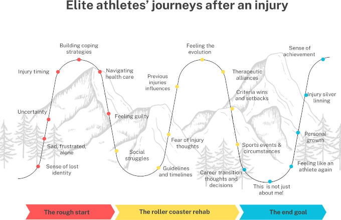
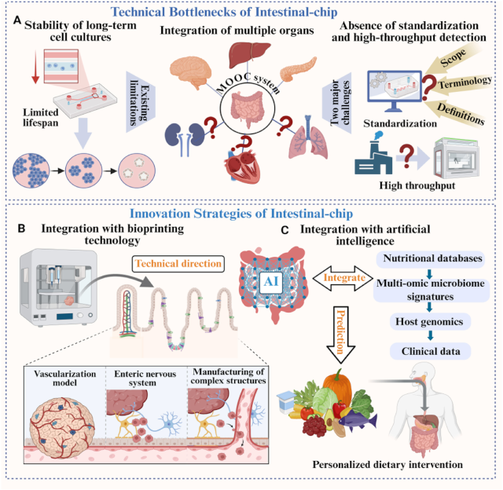

The Athletes Data Community Newsletter (ADCN) is a weekly update on advances in sports-related data collection, management, and reporting. Brad Stenger produces the ADCN. He is a PhD student at the University of Vermont and researches athletes’ data sharing and privacy.

### Translating Research for Injured Athletes' Return To Play

A group of researchers, mostly from the Amsterdam Collaboration on Health & Safety in Sports, interviewed 31 elite athletes from a range of sports and nationalities who had all suffered different kinds of serious injury. The researchers captured their experiences and perceptions with periodic interviews with the athletes throughout their return-to-sport journey. Their paper, [From ‘My world fell apart’ to ‘The best thing that happened in my life’: elite athletes’ longitudinal journeys after an injury](https://bmjopensem.bmj.com/content/12/3/e003320), is open access in *BMJ Open Sport & Exercise Science*.

The authors' analysis identified three journey phases. *The Rough Start* features uncertainty and adjustment to new reality. *The Roller Coaster* features fluctuations in emotions and progress and collaboration with health professionals. *The Journey's End* features reflection, satisfaction, and regained confidence.

The paper's common themes are valuable, and they provide a useful set of reference points. But the authors also emphasize a larger truth. Athletes' journeys are "non-linear and highly individual." Return to play is personalized and should value "individual responses to injury and wider sporting and career context, rather than relying solely on standardised protocols."

A lot of current research on athletes' data research is like this: big picture generalizations. The Injury Journey generalizations are helpful guidance but not super-instructive when it comes to the specific requirements for any single athlete.

[Another recent study](https://link.springer.com/article/10.1007/s40279-026-02543-z) out of FIFA's medical research group investigated differences between return to play, return to competition, and return to performance among professional soccer players (male and female) who experienced ACL reconstruction surgery. Most of these athletes return to sport, they found, but with diminished performance and higher re-injury risk. 

The authors of this paper identify two problematic gaps. The research-practice gap is the separation between research-based technologies and practices and rehabilitation practitioners. The elite practice-research says that practitioners at the elite teams are ahead (sometimes far ahead) of the research.

An example of the two gaps can be seen in the personalized care available at a handful of hospital orthopedic clinics. Seattle Children's [recently opened](https://www.seattlechildrens.org/healthcare-professionals/provider-news/motion-analysis-clinic-better-outcomes/) a new Motion Analysis Clinic that helps create customized treatment plans for pediatric sports injuries and movement disorders. Few sports organizations devote technology like this to injured athletes' rehab, but the ones that do, they tap expertise that far exceeds a metro children's hospital.

Translating research is difficult. And it has become [an important factor](https://federalnewsnetwork.com/contracting/2026/07/the-federal-government-is-going-beyond-funding-research/) for obtaining government research funding in the U.S. The term [valley of death](https://www.ucf.edu/news/nsf-funds-pilot-program-to-support-small-businesses-in-accelerating-commercialization-of-their-late-stage-deep-technology-and-avoid-the-valley-of-death/) is sometimes cited in the case of medical research, describing the gap between research results and widespread utility.

Opportunities to close the research-practice/practice-research gaps that FIFA identified occur at four distinct rehabilitation phases in a continuum, as described in the paper: on-field rehabilitation, return to training, return to competition, and return to competition. Athletes' data metrics are part of each phase and are the translation targets where researchers and practitioners can collaborate. 

A real-world example is the [self-described "grueling" rehab](https://www.nhl.com/islanders/news/from-swimming-to-skating-kyle-palmieri-talks-injury-recovery) that New York Islanders defenseman Kyle Palmieri undertook after an ACL rupture last November. The first three months were spent doing low-impact pool fitness. Next came shared rehab time with teammates, who were the other Islanders with long-term injuries. It wasn't until training camp at the end of the summer that he was skating with the whole team.

One step in the direction of improved RTP is dedicated long-term injury surveillance, like [the long-term program undertaken](https://onlinelibrary.wiley.com/doi/10.1111/sms.70378) by The Football Association in England. The data set, reported in the *Scandanavian Journal of Medicine & Science in Sports*, is the result of 12 seasons of time-loss injuries (15,986 of them over 416 team seasons) in top-level soccer leagues (Premier League, Championship, League One, League Two). Large-scale injury surveillance has significant value: "detecting temporal trends, quantifying injury severity, and establishing stable benchmark values within elite football overall and for specific injury diagnoses."

### Gut-on-a-Chip and Personalized Nutrition

Research into microfluidic systems that emulate the human digestive system has advanced [in China](https://www.sciencedirect.com/science/article/pii/S2665927126002935) and [in the U.S.](https://www.llnl.gov/article/55026/llnl-researchers-have-guts) The Chinese study is a review paper directed at food science applications and biological nutritional efficacy. It assesses the potential to deliver systemic, high-throughput nutrition profiling and challenges blocking industrial scaling for delivering personalized and precision nutrition.

Food industry buy-in for mainstream adoption of commercial personalized nutrition has been [ramping up](https://www.nutritioninsight.com/news/personalized-nutrition-scalable-solutions.html), having recognized consumer demand. A food industry source quoted a representative from Cargill: "45% of 25- to 34-year-olds say they are likely to use apps to help create personalized nutrition plans."

Cargill has a sports nutrition product group and sees the category "broadening beyond performance athletes toward consumers incorporating active nutrition into everyday lifestyle."

Recent research into endurance athletes (cyclists, runners) shows progress toward understanding of the nutrition-metabolism-performance axis. A lot of it relates to carbohydrate fueling for performance, and it all supports the idea that more carbohydrate fuel intake has performance benefit.

Dutch scientists have worked out a [resting metabolic rate equation](https://www.ovid.com/jnls/acsm-msse/abstract/10.1249/mss.0000000000004181~development-and-validation-of-a-resting-metabolic-rate?redirectionsource=fulltextview) for elite cyclists, publishing their paper in *Medicine & Science in Sports & Exercise* (paywall). "Accurate determination of energy expenditure (EE) in elite endurance athletes is critical for personalised nutrition strategies aimed at maintaining health and optimising performance," according to the authors. And this athlete population needs its own equation given the requirements of the sport.

There are papers out of the Research Institute for Sports and Exercise Sciences at Liverpool John Moores University into glycogen stores. [One shows](https://onlinelibrary.wiley.com/doi/full/10.1111/sms.70312) that carbohydrate loading before endurance exercise has no obvious ceiling. A [recent review study](https://onlinelibrary.wiley.com/doi/10.1111/sms.70379) by the same group suggests carbohydrate volumes greater than 8 g/kg*day in the 2 days leading up to competition for a significant glycogen store increase.

[Other work](https://www.insidethegames.biz/articles/bicarbonate-gel-offers-new-competitive-edge) from Liverpool John Moores showed that carbohydrate plus sodium carbonate produced better endurance performance in athletes than carbohydrate by itself. As one would expect by the chemistry, the research also showed sodium bicarbonate helped limit the metabolic acidosis associated with intense exercise by buffering rising hydrogen-ion concentrations. And, also as expected, physiological responses to bicarbonate varied considerably.

Another study, [described in](https://runlongrunhealthy.substack.com/p/can-runners-survive-on-10-grams-of) Brady Holmer's *Run Long Run Healthy* newsletter, shows that minimal carb fueling still needs some carbohydrate intake, at least 10 grams per hour during exercise.

[One final study](https://www.ovid.com/jnls/acsm-msse/abstract/10.1249/mss.0000000000004180~carbohydrate-intake-of-100-vs-60-gh-during-prolonged-cycling?redirectionsource=fulltextview) to mention from *Medicine & Science in Sports & Exercise* (paywall) showed that endurance cyclists taking 100 g/hr carbohydrate were more durable than cyclists who had 60 g/hr carbohydrate intake.

And in case you are curious, and you like your eggs soft- or medium-boiled. The journal *Science* described [the perfect method for a not so hard-boiled egg](https://bsky.app/profile/science.org/post/3mxh35cw4ng25) where the yolk is not too runny, not too firm. The article says to cook an egg in 100°C water for 2 minutes, then 30°C water for 2 minutes, and repeating for a total of 32 minutes. This system led to "perfect" boiled eggs, and it also preserved more egg micronutrients. Weird, but there it is.

### News

[NFL Big Data Bowl 2027](https://www.kaggle.com/competitions/nfl-big-data-bowl-2027) in *kaggle* by The National Football League on October 7, 2026

[The Body Electric: UMass Amherst Researchers Integrate Electronics with Human Cells](https://www.umass.edu/news/article/body-electric-umass-amherst-researchers-integrate-electronics-human-cells) in University of Massachusetts Amherst News by Daegan Miller on October 7, 2026

[Enhancing Recovery in Soccer: A Scoping Review on Nutritional and Supplementation Strategies](https://journals.humankinetics.com/view/journals/ijspp/aop/article-10.1123-ijspp.2025-0634/article-10.1123-ijspp.2025-0634.xml) in *International Journal of Sports Physiology and Performance* by Diogo Martinho et al. on September 21, 2026

[Exploring a systems-based, multifactorial framework for load tolerance and injury risk in women's soccer: A prospective study](https://jsams.org/article/S1440-2440(26)00565-7/fulltext) in *Journal of Science and Medicine in Sport* by Oluwatoyosi Owoeye et al. on September 15, 2026

[Beyond the algorithm: A qualitative study of expert perceptions on the impact of injury prediction models in men’s professional football](https://www.jsams.org/article/S1440-2440(26)00567-0/fulltext) in *Journal of Science and Medicine in Sport* by Francisco Martins et al. on September 21, 2026

[We made a name for ourselves through scouting, analysis, and careful and considered writing. The big hitter every year is SCOUTED50](https://bsky.app/profile/scoutedftbl.com/post/3mxcdnfaabk2b) in Bluesky by *SCOUTED* on October 7, 2026

[The NBA Keeps Drafting Younger. So Why Are Teams Getting Less Patient? Part 2: The Zaccharie Risacher Story](https://www.nbabigboard.com/p/the-nba-keeps-drafting-younger-so-b4b) in *NBA Big Board* newsletter by Rafael Barlowe on October 9, 2026

[Post-match rest day placement and the shape of the week: external load distribution and injury occurrence in two elite football teams.](https://sportperfsci.com/post-match-rest-day-placement-and-the-shape-of-the-week-external-load-distribution-and-injury-occurrence-in-two-elite-football-teams/) in *Sport Performance & Science Reports* by Nikolaos Lekatsas et al. on October 10, 2026

[Weekly Digest: How Does the Body Know How to Heal?](https://tseenergy.substack.com/p/weekly-digest-how-does-the-body-know) in Substack, *The Science and Experience of Energy* by Martin Picard, Nirosha Murugan on October 10, 2026

[How Bob Chesney has completely turned around UCLA](https://www.espn.com/college-football/story/_/id/50125661/2026-bob-chesney-ucla-winning-turnaround) in *ESPN.com* by Paolo Uggetti on October 9, 2026

[As extreme heat intensifies, a patchwork of rules leave student athletes at risk](https://www.wbur.org/hereandnow/2026/10/09/extreme-heat-student-athletes) in WBUR, *Here & Now* and *Grist* by Tik Root on October 9, 2026

[Your cells keep a record of every workout you’ve ever done – and those gains persist even after a break from exercise](https://theconversation.com/your-cells-keep-a-record-of-every-workout-youve-ever-done-and-those-gains-persist-even-after-a-break-from-exercise-291243) in *The Conversation* by Diego Hernandez-Saavedra and Yi-Heng (Hank) Huang on October 7, 2026

[My new short essay- “Rethinking Privacy of the Mind:  Why Protecting Neural Data Is Insufficient”](https://bsky.app/profile/daniel-solove.bsky.social/post/3mxeubkflps2t) in Bluesky by Daniel Solove on October 8, 2026

[WNBA Doctor: Sports Medicine must get better at treating women](https://www.sfltimes.com/health/wnba-doctor-sports-medicine-must-get-better-at-treating-women) in *South Florida Times* newspaper by David Snelling on October 7, 2026

[Why the Car Ride Home Matters](https://sweatscience.substack.com/p/why-the-car-ride-home-matters) in Substack, *Sweat Science* newsletter by Alex Hutchinson on October 7, 2026

[How athletic identity shapes students on, off the field](https://planetdetroit.org/2026/10/student-athletes-life-after-sports/) in *Planet Detroit* by Detroit Writing Room, Robert Thompson on October 7, 2026

[On the Training Science Podcast, Mollie Brewer explains why domain expertise matters when working with large datasets in sport science](https://x.com/hiitscience/status/2107065764284887539) in X,Twitter by HIIT Science on October 5, 2026

[How Pumping Iron Turned Gators Into Wrecking Balls](https://github.com/DrivingWheelProjects/newsletter/blob/main/posts/ADCN_45/How_Pumping_Iron_Turned_Gators.pdf) in *Wall Street Journal* by Robert O'Connell on September 26, 2026

[BC phenom Mara 'one in a million' as a dual-sport D1 athlete](https://github.com/DrivingWheelProjects/newsletter/blob/main/posts/ADCN_45/EmmaHealyBostonGlobe.pdf) in *The Boston Globe* by Emma Healey on October 8, 2026