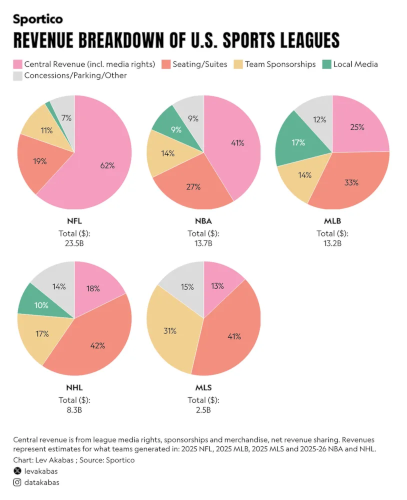

The Athletes Data Community Newsletter (ADCN) is a weekly update on advances in sports-related data collection, management, and reporting. Brad Stenger produces the ADCN. He is a PhD student at the University of Vermont and researches athletes’ data sharing and privacy.

### The Schedule Is The Product

Sports schedules have been changing—significant changes, lots of them, all sports, pro and college. The season is the essential unit of sports. It is the endpoint for the television deal, the ticket package, the most valuable award, the player contract. 

Let's look at schedule changes that are in the works or in pre-works discussion for lots of different sports. It'll give us something we can deconstruct and maybe put in terms of athletes' data.

NHL hockey started [its 84-game season](https://thesickpodcast.com/what-the-84-game-nhl-schedule-means-for-canadas-seven-teams/) in September. It was weird seeing suntanned hockey players with skates and pads on ice. The schedule is longer, plus 2 games, and better, the extra games are head-to-head contests against division rivals. These are high-stakes games with serious playoff implications. The extra games are part of the 2025 collective bargaining between the league and players union.

Things have also gotten interesting schedule-wise at hockey's elite junior level in North America. The Western Hockey League, one of the three leagues that compose the Canadian Hockey League, [added a week to its season](https://www.sportscage.com/hockey/whl/whl-introduces-major-player-focused-changes-for-2026-27-season-12494427) among a set of measures meant to reduce players' travel wear and tear. The league also made the first-round playoffs best-of-five instead of seven. These are teams spread out across Canada's western provinces: Saskatchewan, Alberta, British Columbia.

The CHL has become the entry-level pathway for professional hockey, increasingly drawing the best U.S. teenage talent. USA Hockey [announced plans](https://thehockeythinktank.com/usa-hockeys-new-development-league/) to launch its own Development League (DL) so that the best young Americans play the other best Americans. These developments come as NCAA hockey establishes its post-CHL, pre-NHL player development credential, drawing top NHL draft picks. 

The structure of the elite development pathway is taking shape for North American hockey, but a lot remains to figure out. Where, when, and at what cost (or payout) need to be finalized for young hockey players (and parents).

Next is soccer. Two major professional North American soccer leagues, MLS and NCAA, plan changes to the Fall-Winter-Spring schedule that is in effect for most of the Earth's top-level professionals. USL (United Soccer League), another professional league, [announced plans](https://en.as.com/soccer/challenging-mls-usl-premier-brings-promotion-and-relegation-to-us-soccer-f202609-n/) for promotion and relegation across a three-tier setup with a brand-new league, USL Premier, at the top of the pyramid. MLS and USL both have collective bargaining agreements in place.

Kieran Doyle [looks at](https://bsky.app/profile/americansocceranalysis.com/post/3mxts2azak226) the upcoming MLS schedule change through the lens of the same change in Japan's J-League from a few years ago. He also asks, should NWSL change?

The [NCAA schedule plan](https://sports.yahoo.com/articles/ncaa-approves-proposal-segmented-schedule-104000391.html) splits the season into two windows beginning in the Fall 2027. The longer schedule has long been recommended by University of Maryland coach Sasho Cirovski. The NCAA transfer portal opens after the season ends in May. Coaches have their squads for the entire academic year. 

The schedule lines up with MLS, and it positions all the US leagues to sync with top leagues and player development pipelines in European soccer.

Not that European soccer has figured out its scheduled. FIFA expanded the World Cup last summer with more teams and more games. Dave Richardson, a professor and Premiere League consultant, [told the BBC](https://www.bbc.com/sport/football/articles/cmp3gwz17qn7o) that the problem lies in the best players playing in more than one league, and the leagues do not coordinate schedules. "There is no one body covering the playing schedule, and they all want predominance," he said. "They are all vying for the spotlight and championing their product as the best."

Sidenote: NCAA hockey and soccer are leagues with significant numbers of foreign players on teams. There is [federal legislation](https://sports.yahoo.com/articles/bill-cap-international-athletes-college-091940722.html) (separate from the Protect College Sports Act) that seeks to cap foreign athletes at 20% of a college team roster. College tennis, according to commentator Patrick McEnroe, is 60% international.

Professional tennis might have the most relentless schedule in sports. Every week another tournament, with a calendar that circles the globe. Taylor Fritz [says](https://sports.yahoo.com/articles/taylor-fritz-explains-why-very-160000891.html) that there is no way to shorten the competitive tennis calendar. "You need to play mandatory 500s. You need to play mandatory 1000s. If you want to miss the mandatory 1000s and take the penalties for not playing the 500s, then you're putting yourself I'd say at a pretty serious disadvantage," he told a tennis podcast.

Professional tennis has no players union. The Professional Tennis Players Association (PTPA), a non-union group of tennis pros, has a medical director, Robby Sikka, and has studied injury patterns among players. PTPA has [authored statements](https://www.nine.com.au/sport/tennis/news-competition-schedule-criticism-professional-tennis-players-association-comments-20260811-p60neh.html) claiming that star players have to withdraw from tournaments scheduled to take place in between the four Grand Slam majors.

Cycling, another non-union professional sport, recently saw its non-union association, the UCI, produce a technical report, [The Future of Road Cycling](https://cyclinguptodate.com/cycling/all-three-grand-tours-have-to-be-equal-in-length-there-cant-be-differences-giro-director-luca-guercilena-rejects-proposal-to-shorten-the-race). One recommendation is to limit the big tour races (except Tour de France) to 17 days. Big tour race executives argued in response that 3-week-long races define the sport and have no plans for shorter races.

College athletes have no collective bargaining capability. Overscheduling seems inevitable. Men's and women's college basketball [can now play 32 games](https://www.cbssports.com/college-basketball/news/candid-coaches-college-basketball-regular-season-games/) in their regular season, a number that is up from 28 plus multi-team events that could add up to 3 more games. CBS Sports writer Matt Norlander polled coaches. Fewer than half said that 32 is enough. Most college basketball coaches want more games and will probably get them.

Another interesting development in college basketball scheduling has to do with the metrics used to evaluate teams at the end of the season. Norlander, in [another article](https://www.cbssports.com/college-basketball/news/big-12-basketball-ncaa-tournament-glass-led-court-eligibility-chaos-monster-deal/), describes WAB (Wins Above Bubble). The analytic is one of a handful of key performance evaluators for the NCAA basketball tournament commission. It compares a team's actual game score against an opponent to what the statistical equivalent of a bubble team is projected to perform against that same opponent. 

The metric is one to avoid scheduling grossly inferior teams. Those games are often games where a large school pays a meatball opponent six- or seven-figure payouts. "Buy games" they're called. Norlander spoke to one coach who expects the practice to disappear: "Another 700, 800K to a player instead of [scheduling] North Florida could turn the team."

NCAA college football looks like it will be increasing the playoff tournament from 12 to 24 teams. Former Alabama coach Nick Saban is [on the record saying](https://sports.yahoo.com/articles/much-too-much-nick-saban-201236894.html) that is too many games for too many teams. The larger playoff means that teams that make the finals play 16-17 games. Saban was playing 15-game seasons during his program's peak years. "That was a log of games for college players," he said.

Should athletes in other college sports be worried that their schedules will soon have more games? If those games produce revenue, then yes.

One outlier to the always-more games paradigm is Major League Baseball. MLB recently [proposed a reduced regular season](https://www.reddit.com/r/baseball/comments/1x0xadp/cormier_mlb_announced_theyre_proposing_shortening/), from 162 games to 154. (They also propose adding more playoff games.) Players getting a consistent day off during their workweek was cited as a primary benefit.

Mark Cuban tossed out [the idea](https://www.cbssports.com/nba/news/nba-shorter-games-mark-cuban-proposal-load-management/) to reduce the length of NBA games from 48- to 40-minutes last March. 40 minutes is the game length for most professional basketball leagues (men and women).

The key difference between the two shortening approaches is that the season is the product, in a way that the single game really is not. The season drives the business model. One regular-season game among many is often insignificant. Season-long performance is what determines veteran player salaries, not single-game stats.

The MLB experiment will test whether fewer games can improve the sports product. Athletes' data will have to play a role in optimizing schedules. Athletes' health is central to arguments for less tennis and less soccer. The argument gets stronger as evidence of overuse accumulates.

### Medical AI

A dietician and food writer, Melissa Mitri, [tested ChatGPT as a reliable source](https://www.eatingwell.com/dietitian-tested-chatgpt-nutrition-advice-12165846) for nutrition information. The AI did fine with answers to basic nutrition questions, and it was a helpful source for ideas on ingredients or recipes. To AI's discredit, it failed to communicate accurate research details, and it missed context and nuance. Another dietician, Drew Hemler, told her to think of "GPT as a starting point, not as the final authority."

Cornell medical ethics professor Immaculada de Melo-Martin zags on AI shortcomings in a [recent bioethics essay](https://www.thehastingscenter.org/when-medical-ai-works-well-some-ethical-questions/). She worries about what happens when AI gets things right. A confident AI prediction is a burden, a risk made visible and an obligation based on information, "A risk score, an alert, or a recommendation can make one path seem prudent and another path seem careless." 

Correct answers are not the sole function of medicine, she writes, "It is a human practice organized around care, judgment, responsibility, and trust."

An opinion article, [The invisible risks of AI-generated health information](https://fediscience.org/@fil/117435989864062774), in *Nature Health*, argues that inaccurate guidance and health misinformation are pernicious, invisible actors and a harm to public health. The authors looked at cases where the crap health information came from incidental exposures and cases from active information seeking. 

When established forms of health guidance cause harm, they leave a trace. Health information without transparency cannot be attributed. If the interaction is a chatbot, then the content is visible only to the source of the model behind it. The interaction will also have messaging that is coherent and confident and offers no cue or signal of something amiss.

Until AI systems have monitoring in place that can evaluate guidance and results from guidance, "no one can reliably determine when AI health guidance is wrong." Failures occur, but no one knows how often.

The takeaway is not that AI prediction and guidance should be avoided. The takeaway is that there's skill in knowing how and when to [understand the difference](https://bsky.app/profile/wutsaialliance.bsky.social/post/3mxot3g6mc62w) between good advice and bad advice, whether that advice comes from humans or from AI.

### News

[The Dodgers’ Demise Changes Everything and Nothing](https://www.theringer.com/2026/10/16/mlb/2026-dodgers-obit-brewers-mlb-pennant-nlcs-sweep) in *The Ringer* by Ben Lindbergh on October 16, 2026

[Jacob Misiorowski threw 1,115 pitches at least 100 mph this season. Because of the MLB's rules, he is many more thousands of pitches of away from a long-term contract](https://bsky.app/profile/levakabas.bsky.social/post/3mxwqr7hu3c2z) in Bluesky by Lev Akabas on October 15, 2026

[Does Nick Pivetta’s Injury History Make a $14 Million Option Worth the Risk?](https://sports.yahoo.com/articles/does-nick-pivetta-injury-history-145900847.html) in *Yahoo Sports*, *Athlon* by Pardon Joshua on October 15, 2026

[I’m glad privacy laws are starting to protect neural data, but these protections are often far too narrow to truly protect privacy of the mind.](https://bsky.app/profile/daniel-solove.bsky.social/post/3mxwj4tlim22t) in Bluesky by Daniel Solove on October 15, 2026

[Wysh List: The NHL team being run by a fan](https://www.espn.com/nhl/story/_/id/50182103/nhl-2026-27-devils-sunny-mehta-analytics-poker-gm-wysh-list) in *ESPN.com* by Greg Wyshynski on October 15, 2026

[‘Try to eat really well, 80% of the time’: nutrition expert says healthy eating is easier than you think](https://www.theguardian.com/wellness/2026/oct/14/christopher-gardner-food-sense-interview) in *The Guardian* by Elle Hunt on October 14, 2026

[MLB Has A Rules Problem](https://pitcherlist.com/mlb-has-a-rules-problem/) in *Pitcher List* blog by Asher Dratel on October 12, 2026

[Smartwatch health data are piling up. How can doctors keep pace?](https://www.nature.com/articles/d41586-026-03203-y) in *Nature Index* by Bianca Nogrady on October 14, 2026

[Neck Stiffness Puts Pitchers at Risk of Throwing-Related Injuries](https://today.uconn.edu/2026/10/neck-stiffness-puts-pitchers-at-risk-of-throwing-related-injuries/) in University of Connecticut, *UConnToday* by Anna Zarra Aldrich on October 13, 2026

[Adam Grant on How to “Vibe”](https://davidepstein.substack.com/p/adam-grant-on-how-thowo-vibe) in Substack, *Range Widely* newsletter by David Epstein on October 13, 2026

[MLB playoffs: How Rays, Guardians, Brewers, Dodgers were built](https://www.espn.com/mlb/story/_/id/50163013/mlb-playoffs-2026-rays-guardians-brewers-dodgers-built-signings-trades-payroll) in *ESPN.com* by Bradford Doolittle on October 12, 2026

[Cardiovascular Effects Associated with the Female Athlete Triad: Emerging Evidence Statement from the Female and Male Athlete Triad Coalition](https://link.springer.com/article/10.1007/s40279-026-02525-1) in *Sports Medicine* journal by Emma O'Donnell et al. on October 13, 2026

[Giants Found Unexpected Pitching Depth Amid Injury-Ravaged Season](https://sports.yahoo.com/articles/giants-found-unexpected-pitching-depth-140748981.html) in Yahoo Sports, *RoundtableSports* by Eduardo Solano on October 12, 2026

[Environmental associations with heart-rate responses during field-based submaximal fitness testing in female football players: an exploratory multi-centre study](https://www.tandfonline.com/doi/full/10.1080/24733938.2026.2747385) in *Science and Medicine in Football* journal by Tzil Shushan et al. on October 12, 2026

[Hidden signals in sleep can predict future health](https://www.nature.com/articles/d41586-026-03207-8) in *Nature*, News and Views by Rachel K. Rowe on October 12, 2026

[Sprint acceleration technique is associated with lower limb injury epidemiology in professional male Rugby Union players: a seven-season analysis](https://www.jsams.org/article/S1440-2440(26)00197-0/fulltext) in *Journal of Science and Medicine in Sport* by James Wild and Neil Bezodis on October 1, 2026

[Natural experiments in marathon running](https://journals.physiology.org/doi/full/10.1152/japplphysiol.00792.2025) in *Journal of Applied Physiology* by Daniel Muniz-Pumares et al. on September 1, 2026

[Large language models show distinct multidimensional performance profiles and variable reproducibility in consensus-based bone stress injury](https://esskajournals.onlinelibrary.wiley.com/doi/10.1002/jeo2.70939) in *Journal of Experimental Orthopaedics* by Silvia Gandini et al. on October 7, 2026

[Urinary metabolomic signatures of muscle injury and recovery in elite football players](https://link.springer.com/article/10.1007/s11306-026-02530-5) in *Metabolomics* journal by Guillermo Quintas et al. on September 23, 2026

