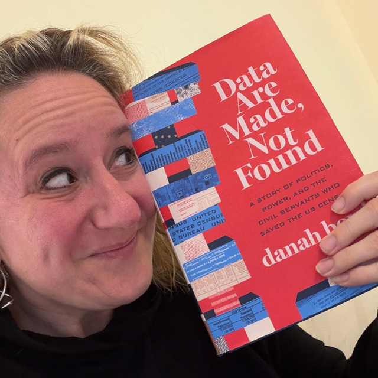

The Athletes Data Community Newsletter (ADCN) is a weekly update on advances in sports-related data collection, management, and reporting. Brad Stenger produces the ADCN. He is a PhD student at the University of Vermont and researches athletes’ data sharing and privacy.

### Keep Cooperating

Harvard economists Ed Glaeser and Davide Viviano have [an editorial](https://www.thecrimson.com/article/2026/10/22/glaeser-viviano-harvard-collaborating-under-grade-cap/) in the *Harvard Crimson* student newspaper. They ask and answer the question, "Should you stop cooperating with your classmates once there are only a fixed number of A's to go around?" Harvard will soon cap the number of A's given in undergraduate courses at 20 percent plus 4 additional students (down from the current 60 percent average). The opinion essay is a response to arguments that students will stop working together.

The argument for making school a solo enterprise is weak, they write. The math is simple. And let me add, the logic applies to sports.

The situation where collaboration moves a person from A to not-A by doing group work is rare. "Extraordinarily unlikely," according to the authors. Participants in group work would need to straddle the margin of whatever the cutoff is, one above and one below. Even in cases where the cooperation benefit is asymmetric, it is far, far less likely that when you are above the cutoff, you will lose rather than gain from working together.

Using the Harvard cap math for a class of 100, the authors set the lagging participant to gain double what the leader gains from collaboration. The leaders' odds of moving up are 1/200. The odds of moving down are 1/39,600—a 200X difference.

The cooperation choice option at Harvard and in sports is different from the mutual dependency that is more often the case in sports. For example, Los Angeles high school sports writer Eric Sondheimer [noticed that chemistry](https://www.latimes.com/sports/highschool/story/2026-10-25/chemistry-can-top-talent-between-quarterbacks-passing-to-receivers) between quarterback and receiver has become a requirement for the pass-heavy football played in Southern California. One high school coach, Rick Clausen, said, "You could be gifted as a thrower, gifted as a receiver, but one without the other is pretty useless."

Lots of the shared work in sports is mandatory. For all sports that have passes, those passes will have human endpoints. 

In two recent games against Spain, the US Womens National Soccer team won zero. Chemistry, not talent, [seems to be the problem](https://bsky.app/profile/womensgamemib.bsky.social/post/3mydbkn6zfk23). The USWNT has the task of finding the right group to play together, which, in all likelihood, will not necessarily be the 11 best players when the next World Cup begins.

The best example right now where more and better collaboration outperforms less and worse collaboration is baseball. Low-budget, mid-market baseball teams from Tampa Bay and Milwaukee dispatched big-budget, major-market New York and Los Angeles. Prioritizing team skills like [balls in play](https://www.espn.com/mlb/story/_/id/50214717/world-series-rays-brewers-first-look-preview), [fielding](https://www.nytimes.com/athletic/7720788/2026/10/25/rays-brewers-world-series-game-2-blown-lead/), and [baserunning](https://www.espn.com/mlb/story/_/id/50263667/rays-ease-basepaths-losing-game-1-world-series) gave them an edge against teams built around three true outcomes (strikeouts, walks, home runs). (Note: Fielding and baserunning errors have cost the Rays the first two World Series games.)

The Brewers have $146 million in player payroll (14th in MLB). Tampa Bay has $79.3 million (24th in MLB). Anthony Castrovince [describes](https://www.mlb.com/news/brewers-rays-scouting-investment-world-series-2026) the front office operations investments in things like scouting that offset the teams' on-field spend, specifically their investments in analytics and scouting. Milwaukee has a 64-person scouting department and a process that emphasizes being around players and then "blending" what they learn with the rest of the organization's information to make decisions. 

It's an 80-person department for Tampa Bay. “Maintaining a robust scouting staff,” said Rays vice president and assistant general manager Kevin Ibach, “allows us to look at these players through a subjective lens and challenge some of the data that we also have working for us as well.”

If working together has clear benefit for undergrads at Harvard, for players on a team, and for staff in a front office, does the principle apply to teams in a league? It does if you believe the thesis of [a new book](https://zephoria.substack.com/p/todays-the-day) by danah boyd titled *Data is Made, Not Found*.

This is the story of the 2020 US decennial census, reported by a Cornell sociologist. The fundamental tension comes from competing aspects of a census: one, to be accurate; two, to be useful; and three, to keep confidential personal information private.

Computer scientist Simson Garfinkel [summarizes the tradeoff](https://databasenation.substack.com/p/data-are-made-not-found-book-review) and gives it a name, the Fundamental Law of Information Recovery. The law states that "if you answer too many questions too accurately on a confidential database, the confidentiality of that database will suffer, and typically in a spectacular way."

The 2020 census used a mathematical framework called Differential Privacy to manage the tradeoffs and to produce the data needed for public policy. Making data that has broad utility is an effortful process. As more data becomes available, it will take more work to make useful and accessible, but still private.

Differential Privacy is an active area of research. Last June the Census Bureau [banned the framework](https://talkingpointsmemo.com/news/how-a-baseless-right-wing-social-media-panic-led-to-dramatic-changes-at-the-census-bureau) over concerns about its accuracy. A [new investigation](https://mitsloan.mit.edu/press/new-research-finds-privacy-protections-preserve-most-social-science-findings-amid-growing-census-data-debate) from MIT and Carnegie Mellon took public data sets used for social science research and made that data differentially private, then re-ran the social science studies. 91% of the published social science conclusions remain intact despite the noise injected with Differential Privacy.

As differential privacy becomes a more established method for data sharing, concerns should fade. Best practices for how to share data will still be a challenge. Research published over the summer showed that [coordinated data sharing is more accurate and more useful](https://arxiv.org/abs/2602.09357) than decentralized data sharing. Data is made by working together. Working together is almost always a better result than not working together.

### Innovations in Load Management

Shohai Ohtani did not thrive for the Los Angeles Dodgers during the team's now-over postseason. Ohtani made headlines [announcing his intention to pitch](https://codysnavely.substack.com/p/shohei-ohtani-makes-his-2027-pitching) next season. Critics felt that Ohtani's pitching during the past regular season caused injury problems that ultimately diminished his hitting performance during the MLB playoffs. 

The question is what to do? Ohtani seems to have [his own plan](https://www.mlb.com/news/shohei-ohtani-2026-injury-timeline-dodgers-lessons) and said that he'll consult with his trainers on a program that solves his physical issues and prepares him for success next season. 

The Dodgers have [their plan](https://sports.yahoo.com/articles/ohtani-surgery-not-table-dodgers-214154422.html). Team director Andrew Friedman said that Ohtani did not need surgery and that they will study what just occurred. He explained that Ohtani's physical problems with his bicep and with his knee made it difficult to get Ohtani back to 100 percent. The situation proved unmanageable, but the organization expects to learn from it.

Fans, or sportswriter voices of fans, have [their plan](https://sports.yahoo.com/articles/dodgers-urged-trade-shohei-ohtani-113000805.html). They look at a 32-year old Ohtani and ask what is realistic given he was 29 the last time he was able to do both. They suggest trading Ohtani and all of his Wins Above Replacement so that this late-season disappointment does not reoccur.

Ohtani and the Dodgers might take a page from NBA teams that have either announced or invited speculation about what load management looks like for aging superstars as the news gets underway. You can read about plans for [Stephen Curry](https://www.hoopshype.com/story/sports/nba/2026/10/16/steve-kerr-shorter-season-the-only-solution-to-load-management-problem/92278082007/), [Giannis Antetokounmpo](https://www.hoopshype.com/story/sports/nba/2026/10/16/steve-kerr-shorter-season-the-only-solution-to-load-management-problem/92278082007/), [Kevin Durant](https://www.si.com/nba/rockets/onsi/rockets-star-kevin-durant-pushes-back-on-load-management-idea-01m4ehykn7ew), [Kawhi Leonard](https://sports.yahoo.com/articles/kawhi-leonard-limited-first-day-181459312.html), [Joel Embiid and Lebron James](https://www.nytimes.com/athletic/7643766/2026/09/29/sixers-joel-embiid-lebron-james-load-management-conversations/).

NHL hockey has downplayed load management as a function of hockey culture and of league parity. But [it happens](https://scienceforsport.fireside.fm/291).

Hockey player resting norms may now be different for goalies. The Maple Leafs told #1 goalie Sergei Bobrovsky to [stay home and rest](https://thehockeynews.com/nhl/toronto-maple-leafs/latest-news/it-s-a-smart-thing-to-do-sergei-bobrovsky-a-fan-of-maple-leafs-three-goalie-plan-for-back-to-back-games) for a recent roadtrip. The team has a 3-goalie rotation. Three goalies is also something that the Edmonton Oilers [plan](https://oilersnation.com/news/oilers-three-goalie-system-mcdavid-andersen-levi) to put in place.

### News

[Surviving the Schedule: How Back-to-Back Games Will Hurt or Help NBA Teams in 2026-27](https://www.sportsbettingdime.com/news/nba/back-to-back-nba-scheduling/) in *SportsBettingDime.com* by Paul Costanzo on October 8, 2026

[No Pain, No Privacy: Athletic Wearables and the Limits of Consent](https://deeptech.duke.edu/blog-post/no-pain-no-privacy-athletic-wearables-and-limits-consent/) in Duke University, *Deep Tech* blog by Cassidy Hurd & Holden Buchanan on August 11, 2026

[Sports Data: Sources, Infrastructure, and Governance in AI Era](https://www.mdpi.com/2673-8392/6/10/213) in *MDPI Encyclopedia, Mathematics & Computer Science* by Jerred Junqi Wang on October 1, 2026

[The Power of Performance Data](https://wp.stolaf.edu/news/the-power-of-performance-data) in *St. Olaf Magazine* by Kari VanDerVeen on May 21, 2026

[College football programs are betting on AI. Can programs manage the risks?](https://www.nytimes.com/athletic/7644119/2026/09/30/college-football-programs-ai-risk/?unlocked_article_code=1.FFE.Ag0d.3gbxrfAv1XzG&source=emp_shared_article&smid=url-share-ta) in *The Athletic* by Austin Meek on September 30, 2026

[On the theory and practice of estimating sensor-to-segment orientation with a single inertial sensor: A tutorial](https://www.sciencedirect.com/science/article/pii/S0021929026004409) in *Journal of Biomechanics* by Reed Gurchiek on October 12, 2026

[NFLPA calls for 'full investigation' into medical care provided to Eagles' Hurts](https://www.espn.com/nfl/story/_/id/50233573/nflpa-demands-full-investigation-hurts-medical-care) in *ESPN.com* by Tim McManus on October 20, 2026

[College football mega boosters used to fund buildings. Now they buy QBs. What’s the payoff?](https://links.e1.nytimes.com/a/zc/5037/dfa777a3008d42468566e5243db833f5/2316268c5b5b4a47bfff1446eb3a08a8) in *The Athletic* by Justin Williams on October 21, 2026

[Should You Train Like Vinny Mauri? 5 Marathon Experts Weigh In](https://marathonhandbook.com/should-you-train-like-vinny-mauri-5-marathon-experts-weigh-in/) in *Marathon Handbook* by Amby Burfoot on October 19, 2026

[ARPA-H kicks off work to advance next-generation personalized biosensors](https://arpa-h.gov/news-and-events/arpa-h-kicks-work-advance-next-generation-personalized-biosensors) in *ARPA-H.gov* on October 1, 2026

[Ohio State Announces Renovations for Woody Hayes Athletic Center](https://www.elevenwarriors.com/ohio-state-athletics/2026/10/164681/ohio-state-announces-renovations-for-woody-hayes-athletic-center) in *Eleven Warriors* blog by Rodney Potts on October 17, 2026

[Building a research legacy inside elite sport](https://www.uts.edu.au/case-studies/building-a-research-legacy-inside-elite-sport) in University of Technology Sydney, Case Studies by Aaron Coutts and Blake McLean on October 2, 2026

[Steve Kerr Gets Real About the Warriors](https://www.theringer.com/2026/10/21/nba/steve-kerr-golden-state-warriors-roster-trades-nba-season) in *The Ringer* by Logan Murdock on October 21, 2026

[WSJ: Are cushiony shoes (aka super shoes) injuring runners?](https://www.letsrun.com/forum/flat_read.php?thread=14422238) in *LetsRun.com* by rojo on October 22, 2026

[A modern-day dynasty: What NC State women’s cross country built](https://www.ncaa.org/stories/a-modern-day-dynasty-what-nc-state-womens-cross-country-built/) in *NCAA.org Stories* by Asha Evans on October 15, 2026

[The Process - Lessons from Nick Saban](https://nickdimarco.substack.com/p/the-process)

[The Transient Window](https://sportrxiv.org/index.php/server/preprint/view/1137) in *SportRxiv* by Stuart McMillan and Gerry Ramogida on October 23, 2026

[A “robo ump” that calls balls and strikes in Major League Baseball makes its World Series debut this week. It has to be near-perfect. ](https://bsky.app/profile/science.org/post/3myipibqcmq2o) in Bluesky, *Science Magazine* by Jon Cohen on October 22, 2026

[Garmin personal API gives athletes their own data back](https://the5krunner.com/2026/10/22/garmin-personal-api/) in *the5krunner* on October 22, 2026

[The anatomy of a personal health agent](https://www.nature.com/articles/s41586-026-11161-8) in *Nature* journal by A. Ali Heydari et al. on October 21, 2026

[The AI Inference Problem in Privacy Law](https://danielsolove.substack.com/p/the-ai-inference-problem-in-privacy) in Substack, *Solove on Tech* newsletter by Daniel Solove on October 21, 2026

[Q and A with Devin Cooley: Flames goaltender talks latest viral moment](https://www.sportsnet.ca/nhl/article/q-and-a-with-devin-cooley-flames-goaltender-talks-latest-viral-moment/) in *Sportsnet* by Eric Francis on October 20, 2026

[My new @sportico.bsky.social column: Kansas signing Trey Kaufman-Renn exposes a fundamental challenge for the NCAA.](https://bsky.app/profile/mccannsportslaw.bsky.social/post/3myf4x76njc2a) in *Bluesky* by Michael McCann on October 21, 2026

[Female Athlete Research Forum | Decoding menstrual health across the lifespan with wearables](https://www.youtube.com/watch?v=Xj9W5j3oQM0&t=3s) in *YouTube* by Wu Tsai Human Performance Alliance on October 20, 2026
