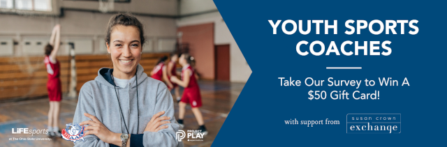

The Athletes Data Community Newsletter (ADCN) is a weekly update on advances in sports-related data collection, management, and reporting. Brad Stenger produces the ADCN. He is a PhD student at the University of Vermont and researches athletes’ data sharing and privacy.

### Managing Overuse Injury

The NBA has an early-season injury problem. Two weeks into the season, and there were 79 NBA players [listed](https://www.theringer.com/2026/10/30/nba/nba-injuries-health-players) as unavailable due to injury or illness on the October 28 injury report. There are only 450 players on NBA active rosters, which means that 17 percent of them are injured.

How does that figure compare to hockey? According to the Kalshi prediction market NHL [injury tracker](https://kalshi.com/nhl/injury-report), there are 113 (out of 726) NHL hockey players on teams' injured lists. The hockey number works out to about 15 percent.

Late-season NHL hockey games have higher stakes than early-season games, so it makes sense to sacrifice some win probability by holding established players out early in the season when it makes them healthier for the stretch run.

The [competitive balance among NHL teams](https://www.sportsbusinessjournal.com/Daily/Issues/2016/03/14/Leagues-and-Governing-Bodies/Bettman/) keeps the standings close. The gap between good and mediocre teams is small, and both groups will stay in contention for playoff spots for nearly the full length of the regular season. 

Early-season opportunities for younger, not-established players can also provide roster management benefits if those substitutes can perform at a level that maintains the team's good (or even mediocre) win-loss record. If a couple of young players pass their professional tests, then that team raises its talent level. And because the top-line players are out, their top-line minutes and statistics (and paydays) are effectively unchanged. 

As long as the young talent comes through, everyone (the team, the veterans, the reinforcements) all win. If not, game losses and a team-wide [injury cascade](https://newsletter.bradstenger.com/posts/ADCN_43/index.html#disaster-cascades-in-the-form-of-injuries) become likely.

A quick check of the NHL teams going through injury problems, and it's the [Islanders](https://sports.yahoo.com/articles/ryan-pulock-exits-early-latest-013716507.html), [Hurricanes](https://www.newsobserver.com/sports/nhl/carolina-hurricanes/article317683440.html), [Canadiens](https://sports.yahoo.com/articles/canadiens-announce-mixed-bag-injury-201857062.html), [Wild](https://www.twincities.com/2026/10/19/amid-early-season-injuries-wild-learning-to-win-with-what-they-have/), and [Avalanche](https://www.si.com/nhl/avalanche/onsi/news/avalanche-receive-troubling-injury-updates-on-3-forwards-ahead-road-trip). These are teams who can be confident that they have sufficient talent to sacrifice an early-season game or two while developing newer, often younger, players.

The current NBA injury scare may just be an indication that [the league's competitive balance](https://www.sportico.com/leagues/basketball/2026/nba-title-champion-history-adam-silver-parity-1234952621/) and late-season stakes are in a better place than the tankapalooza of recent years.

NBA players are still getting hurt, but league-wide incentives to make the end of the season more competitive change how teams manage injuries and manage their rosters. Perspectives on why elite basketball players keep getting hurt have arrived at a [consensus](https://www.si.com/nba/why-nba-injury-problem-how-it-can-be-fixed): the more athletic playing style, the intense NBA schedule, the wear and tear from unregulated elite teenage basketball.

These are, in a word, overuse injuries. They occur when athletes undertake efforts that exceed their body's capacity to recover. The situation is simple enough to understand, but in terms of athletes' data, the situation is challenging at many levels.

There are two paths to overuse injury. An athlete can be *unprepared* for the physical demands of training or competition. An athlete can also be *underrecovered* from past training or competition. The two are more codependent than mutually exclusive, a yin and yang for modern elite athletes.

Physical preparation metrics include the long list of the performance and biometric measures that go into training load calculation. Recovery metrics start with sleep and stress-related heart rate measures (resting heart rate, heart rate variability) and extend into non-sleep recovery (message, normatec) and nutrition. Marginal gains apply to both sets of metrics. Tissue status indicators (biomarkers, imaging, elastography) complicate things further. 

The quantity of applicable athletes' data is enormous. Athletes' data context adds to the challenges. Modern athletic development creates a dynamic balance between preparation and recovery. Physiology does not help. Different tissues (muscles, tendons, bones) adapt and recover at different rates, all subject to further metabolic variation that is [highly individualized](https://newsletter.bradstenger.com/posts/ADCN_48/OutrunInjury.pdf). 

Athlete management systems are imperfect aids. [New research](https://sportrxiv.org/index.php/server/preprint/view/1140) from professional women's soccer in Norway shows that athlete monitoring systems are prone to false alarms, actually false alerts, that add to staff workload. Only 0.2–1.2% of new alerts (based on acute-chronic workload ratio, training load increase, wellness scores, or training monotony score) were followed by an actual injury report.

If the goal is to have the team's best players ready for a championship run through the playoffs, cautious health management early in the season makes for bouts of detraining and retraining throughout the season. The injured-list resets are easier than ongoing assessments and rehabs for small (but playable) impairments.

Jess McClain had a great finish, second place, in the 2026 New York City Womens Marathon.  Overuse injuries had plagued her initial post-college professional career. Her contract with Brooks led her to train with a group in Seattle. In [an interview](https://marathonhandbook.com/jess-mcclain-2024-nyc-marathon-interview/) before the 2024 NYC marathon, McClain described how seasonal affect, weight training, high mileage, and three hard workouts per week contributed to stress fracture injuries. "I resolved then that I was never going to let myself get to a starting line not healthy again," she said at the time.

McClain [streamlined her training](https://www.flotrack.org/articles/16318580-a-streamlined-training-routine-fuels-jess-mcclains-resurgence) this year, working with new coaches, Megan and David Roche, who are highly data-literate. (Megan Roche's MD/PhD at Stanford focused on female athlete health.) David Roche [told LetsRun.com](https://www.letsrun.com/news/2026/11/sheila-chepkirui-wins-nyc-marathon-jess-mcclain-ends-eight-year-american-podium-drought-with-surprise-second/) that he focused training on "zone compression" (changing paces, moving between below and above threshold). According to David Roche, McClain could recover and shuttle lactate while still running at 5:20 per mile. McClain ran the last four miles at 5:15 pace, faster than the race winner, Sheila Chepkirui.

Overuse injury at the highest levels of endurance competition can be mitigated. Challenges bridge suffering and success. The challenges are as inevitable as the overuse, and very difficult to overcome.

### US Coaches Survey

The National Coach Survey is a collaboration between the Aspen Institute for Project Play and researchers at The Ohio State University Sports and Society Institute. I research athletes' data. Coaches' data is its equally important counterpart. 

The National Coach Survey targets **ALL youth sport coaches who work with young people in any sport setting** including organized sport and free play. 

The survey questions focus on: (1) coaches’ background and training, (2) the reason they began coaching and what keeps them coaching, (3) their confidence level based upon their training, (4) the additional supports they need to be an effective coach, and (5) their perceptions of the current youth sports system in their community.

This short online survey should be taken by **anyone who is or has been a youth sports coach** and will take 20-30 minutes to complete. For respondents willing to provide an email address, one person from every 500 will win a $50 electronic gift card. 

Tell your colleagues and take the survey online at [as.pn/coachsurvey](https://as.pn/coachsurvey).

### News

[Brain Disease Is Pervasive in N.F.L., New Estimate Suggests](https://www.nytimes.com/2026/10/28/science/brain-disease-cte-nfl-football.html) in *The New York Times* by Carolyn Y. Johnson and John Branch on October 28, 2026

[Can Scientists Make Football Safer?](https://www.nytimes.com/2026/10/28/science/cte-nfl-football-brain-safety.html) in *The New York Times* by Lynne Peeples on October 28, 2026

[Knee Surgery Isn’t Always the Answer. Here’s How to Avoid It.](https://www.nytimes.com/2026/10/28/well/move/avoid-knee-surgery-advice.html) in *The New York Times*, *Well newsletter* by Ian McMahan on October 28, 2026

[Panthers Laying Groundwork for On- and Off-Field Transformation](https://sports.yahoo.com/articles/panthers-laying-groundwork-off-field-183942787.html) in Yahoo Sports, *Front Office Sports* by David Rumsey on October 27, 2026

[The Age of Knowledge is Ending. Welcome to The Decision Renaissance](https://teamworks.com/blog/welcome-to-the-decision-renaissance) in *Teamworks Blog* by Bryce Murphy on October 27, 2026

[How the Brewers Became Baseball’s Blueprint](https://www.theringer.com/2026/10/29/mlb/how-the-brewers-became-baseballs-blueprint-world-series) in *The Ringer* by Ben Lindbergh on October 29, 2026

[Why Micah Parsons' ACL recovery is taking longer than Patrick Mahomes'](https://www.espn.com/nfl/story/_/id/50307555/packers-micah-parsons-return-acl-patrick-mahomes) in *ESPN.com* by Rob Demovsky on October 29, 2026

[Understanding female athletes could optimise performance for all athletes](https://www.essa.org.au/Web/Resources/Articles/2026/Feature-article-understanding-female-athletes-could-optimise-potential-for-all.aspx) in *Exercise & Sports Science Australia* by Clare Minahan on September 1, 2026

[Reconsidering Individualism and Collectivism](https://www.psychologytoday.com/us/blog/for-a-better-world/202609/exploring-individualism-and-collectivism) in *PsychologyToday.com* by Miles Thompson, Rachel Peal, and Ada Toprak on October 29, 2026

[Achilles injections show no meaningful benefit over sham treatment](https://bmjgroup.com/achilles-injections-show-no-meaningful-benefit-over-sham-treatment/) in *The BMJ* press release on October 28, 2026

[In a new article published in J Biomech, Hida et al. examine age-related adaptations in propulsive and braking mechanisms during gait acceleration and deceleration by analyzing spatiotemporal gait parameters, ground reaction forces, and center of mass external moment.](https://bsky.app/profile/jbiomech.bsky.social/post/3mz237j7kjs2f) in *Bluesky*, *Journal of Biomechanics* on October 29, 2026

[What Olympic Gold Medalist Tara Davis-Woodhall Uses to Recover After Her Hardest Training Days](https://www.womenshealthmag.com/fitness/a74283761/tara-davis-woodhall-training-essentials/) in *Women'sHealth* by Natascha Grief on October 29, 2026

[The Shapeshifting Brewers](https://www.joeposnanski.com/p/the-shapeshifting-brewers) in *JoeBlogs* by Joe Posnanski on October 29, 2026

[The science of a sporting edge](https://www.jpost.com/israel-news/culture/article-912925) in *The Jerusalem Post* by Alan Rosenbaum and Tel Aviv University on October 29, 2026

[Upside Analysis: Physical AI: The Next Major Revolution in Elite Sports?](https://www.theupside.us/p/upside-analysis-physical-ai-the-next) in *The Upside Newsletter* by Julien Blin on October 29, 2026

[Putting Performance First: Measuring What Matters in Sports Science Research](https://journals.humankinetics.com/view/journals/ijspp/aop/article-10.1123-ijspp.2026-0559/article-10.1123-ijspp.2026-0559.xml) in *International Journal of Sports Physiology and Performance* by Christopher J. Stevens and Lee Taylor on October 29, 2026

[Could a blood sample, a brain scan and a look at your phone data transform how your psychiatrist treats you?](https://bsky.app/profile/nature.com/post/3mywsz3qihf2c) in *Bluesky*, *Nature* journal on October 28, 2026

[Columbus breaks ground on 45,000-square-foot NWSL training facility ahead of 2028 team launch](https://sports.yahoo.com/articles/columbus-breaks-ground-45-000-202643384.html) in Yahoo Sports, *USA Today* by Jon Arnold on October 27, 2026

[Men's college soccer celebrated its move to a fall-spring season. But behind the scenes, there's a strong push to block it.](https://bsky.app/profile/henrybushnell.bsky.social/post/3myu73pymhk2c) in *Bluesky* by Henry Bushnell on October 27, 2026

[Asics Makes $25 Million Bet on North American Innovation](https://sgbonline.com/exec-asics-25-million-bet-on-north-american-innovation/) in *SGB Media* by Thomas J. Ryan on October 26, 2026

[Jalen Hurts played a game with a blood clot, then flew across the Atlantic. His condition later worsened. Could the Eagles face legal consequences?](https://bsky.app/profile/mccannsportslaw.bsky.social/post/3myrvs6i5wk2e) in *Bluesky* by Michael McCann on October 26, 2026

