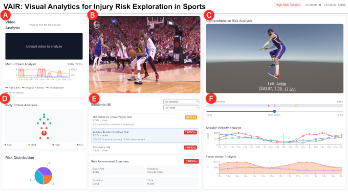

The Athletes Data Community Newsletter (ADCN) is a weekly update on advances in sports-related data collection, management, and reporting. Brad Stenger produces the ADCN. He is a PhD student at the University of Vermont and researches athletes’ data sharing and privacy.

### Visualizing is Thinking

Election week is, for many in the data journalism community, the Super Bowl without the football. All eyes are on the data and the data visualizations. Lots of magic graph picture boards. Randy Au writes the data nerd newsletter [Counting Stuff](https://counting-stuff.com) and Au apologized in his newsletter for sitting out the election data drama. Instead, he gave readers an essay on exploratory data analysis (EDA) and why it's better to do EDA work without AI help.

"I think it bears reiteration in the modern age—when doing an analysis, it is still required to personally, manually, look through the data with your own eye balls," Au writes. Just like writing is thinking, [EDA is thinking](https://bsky.app/profile/randyau.com/post/3mzgmcy2nwc2u), and not the type of thinking that you can leave to automation. "Your intentionality is missing," he says.

I enjoy exploratory data analysis, and I especially enjoy data visualization for data exploration. There is an originalist school of thought that says [paper and ink](https://graphpaper.substack.com/p/data-visualisations-digital-production) will still produce uniquely valuable insights along with dramatic, artistic presentation. No one calls me an originalist. (But I am a fan of originalists. Check out [this Budapest newspaper](https://bsky.app/profile/unravelsports.bsky.social/post/3msg4zg4ubs2x) from 1924.)

My visualization know-how started with the [D3 viz library](https://d3js.org/) and the way it mapped data structures to on-screen pixels. D3 has since evolved to become [Observable](https://observablehq.com/), a notebook-style programming platform for data viz. Both tools have a bias, that visual data representation is as complex as the data's organization. Your visualization makes sense if and only if the organization of structured data makes sense.

The data visualization research community holds its annual conference, [IEEE Vis](https://ieeevis.org/year/2026/welcome), in Boston starting on November 9. Danyel Fisher created a [fantastic search tool](https://ieeevis.danyelfisher.info/?story=ieeevis&stop=start) for the Vis conference program. [As we saw](https://newsletter.bradstenger.com/posts/ADCN_40/index.html#engineeringstatistical-analysis-at-2026-jsm) at the Joint Statistical Meeting in August, athlete tracking and biomechanics are subjects for top-tier interdisciplinary analytical research.

Vis conference papers to highlight:

[PoseForge: Editable Pose Analytics for AI-Assisted Sports Coaching](https://ieeevis.org/year/2026/program/content/735d1607-6743-4f0e-8b86-1a793d35d531/) ([arXiv](https://arxiv.org/abs/2608.05971)) is a visual analytics system that presents 3D skeletal poses of interactive movement analysis for cricket players and coaches

[Authoring Narrative Visualization in Motion:Visual Storytelling in Swimming Videos](https://ieeevis.org/year/2026/program/content/aede009e-85e8-4949-966c-bb1e01a96921/) ([arXiv](https://arxiv.org/abs/2607.14924)) automates storytelling by tracking swimmers participating in high-level competition

[VIGMA: An Open-Access Framework for Visual Gait and Motion Analytics](https://ieeevis.org/year/2026/program/content/1da6f750-8fe6-4cf4-8ccb-6b0b0fd097f7/) ([arXiv](https://arxiv.org/abs/2504.17960)) is a general-purpose visual analytics framework for all types of gait analysis

[Who's That Player?: Externalizing Query Interpretation in Spoken XR Sports Interaction](https://ieeevis.org/year/2026/program/content/a6a811db-f906-4dea-bae8-5a160321102e/) ([arXiv](https://arxiv.org/abs/2608.00876)) is a spoken language interface that keeps up with game activity in an immersive sports interaction system by narrowing the scope of queries along four dimensions: temporal, metrics, referential, and spatial

Vis researchers will also put work in academic research outlets for computer vision and health technology. Authors of the last paper in the list, Chunggi Lee and Hanspeter Pfister from Harvard, also created a [computer-vision system to gauge real-time injury](https://vcg.seas.harvard.edu/publications/vair-visual-analytics-for-injury-risk-exploration-in-sports/paper) for basketball athletes presented on video. The work came out late in 2025 at the [IEEE Workshop on Visual Analytics in Healthcare](https://visualanalyticshealthcare.github.io/homepage/2025/).

Quality proof-of-concept papers that describe video classification of sports tracking and biomechanics poses, actions, and events appear regularly on arXiv. Recent examples:

Soccer: [Zero-Shot Multimodal Event Spotting in Soccer Broadcasts](https://arxiv.org/abs/2610.37583)

Volleyball: [Volley3D: Unified 3D Full-Sequence Reconstruction from Monocular Broadcasts]()

Basketball: [Explaining Basketball Shot Classifications with Grad-CAM: An Investigation of Shortcut Reliance with Spatiotemporal Correlations](https://arxiv.org/abs/2610.33263)

More basketball: [Training-Free Long-Term Multi-Object Tracking for Sports Video Analytics](https://arxiv.org/abs/2608.15688)

Track: [MuyBridge: Mobile Human Center-of-Mass Estimation from Monocular Video via Sparse Fusion](https://arxiv.org/abs/2609.02854)

These papers all come out of university research and fit the profile of exploratory data analysis. The volume of work on video in sports is substantial. Non-video work is a little harder to come by. 

There is one 2026 Vis conference paper, [Field Guide: Making Lived Uncertainty Interpretable in Women’s Return-to-Play](https://ieeevis.org/year/2026/program/content/06b575e8-cd09-4d81-be06-98541f58adab/)([LinkedIn](https://www.linkedin.com/posts/rhiannonsowen_making-lived-uncertainty-interpretable-in-ugcPost-7503806585253785600-ss-L/)), that presents narrative visualizations of 39 mothers who describe their soccer return-to-play experience.

Another Vis conference paper, [Human-centered evaluation of data visualization understanding in vision-language models](https://arxiv.org/abs/2505.17202v2) from Stanford researchers, compared explanations from vision-language models that train on both text and images to human understanding of data visualizations. AI data visualization literacy trailed human performance, lending credibility to Randy Au's view on AI shortcomings for EDA.

Tableau is a Salesforce subsidiary company that originally spun out of Stanford data visualization research. The company's R&D group recently presented a smart semantic assistant called [Ptolemy](https://www.tableau.com/blog/ptolemy-semantic-map-exploratory-data-analysis) for visual exploratory analysis at the [ACM UIST](https://uist.acm.org/2026/) (User Interface Software Technology) conference in Detroit.

Joe Marks, a former Harvard professor and research executive at Disney, wrote [a seminal paper](https://dl.acm.org/doi/abs/10.1145/3596711.3596721) that described Design Gallery interfaces in 1997. These interfaces allowed users to specify digital animation parameters and their ranges and computationally presented a user with samples to choose from based on data point sets of those parameter combinations. Choosing from options replaced time-consuming manual tweaking of these design parameters. 

Tableau's Ptolemy is in the Design Galleries tradition. According to one of its developers, "Most tools externalize results without exposing the structure of the analytic journey itself. Ptolemy helps to change that and represent data analysis as a space in which you can move, navigate, and explore." Good EDA tools can do that. Using less sophisticated LLM tools for EDA does not.

### Investing in Womens ACL Research

The Football Association (FA) and Women's Super League (WSL and WSL2) have teamed with Imperial College London to study ACL injuries to women's soccer athletes. The aim, according to [one article](https://shekicks.net/fa-wsl-acl-injury-research-project/), is "to find out why anterior cruciate ligament ruptures keep happening." 

Last April the National Women's Soccer League in the US [announced](https://www.theguardian.com/football/2026/apr/22/project-acl-injuries-nwsl-wsl) that it had joined a three-year research initiative, Project ACL, that started in 2024 between the Women's Super League, the Fifpro players' union, the FA, Nike, and Leeds Beckett University.

According to *The Guardian* newspaper, "The Project ACL team has conducted interviews with more than 30 players and led surveys across all 12 WSL clubs about resources and injury prevention strategies, with plans to do the same for the NWSL’s 16 clubs."

Sports scientist James Malone writes *The Football Scientist Newsletter*, and he [recently summarized](https://maloneperform.substack.com/p/acl-injuries-in-womens-football-what) a two-part set of UEFA consensus papers on ACL injury management in women's football. Part one focuses on injury risk factors and prevention strategies. Part two focuses on rehabilitation, return to play, and the psychological experiences of injured players.

To summarize a summary, the UEFA guidelines posit that injury risk is multi-factorial, prevention requires a multi-component program, and rehabilitation should focus on criterion-based progression instead of time loss. The key message, according to Malone, is that it's an ongoing process: "The challenge is not simply knowing which exercises, tests, or rehabilitation strategies to use, but ensuring they are implemented consistently and adapted to the individual player and their football environment."

Andrea Hudy, the strength coach at the University of Connecticut women's basketball team, told me that she felt that the ACLs in professional women soccer and basketball athletes are comparable to the UCLs in professional baseball players. The demand of their sport exceeds (in most cases) the biological integrity of the tissue. Prevention will only get an athlete so far.

Maybe so. Maybe not. That's a good reason to invest the resources and do the research.

### News

[Beyond basketball - The evolution of the K-Lab, from research to education](https://medschool.duke.edu/stories/beyond-basketball) in *Duke University School of Medicine, Stories* by Carol Habers on October 27, 2026

[NBA scouts missed Yaxel Lendeborg’s greatness with an easy mistake](https://www.sbnation.com/nba/1134699/yaxel-lendeborg-warriors-rookie-nba-draft-scouts-missed) in *SBNation* by Ricky O'Donnell on November 3, 2026

[Who is Jason Kanzler? Here’s what to know about Mariners’ new manager](https://www.seattletimes.com/sports/mariners/who-is-jason-kanzler-heres-what-to-know-about-mariners-new-manager/) in *The Seattle Times* by Adam June and Ryan Divish on November 3, 2026

[How the NBA Became a Young Man’s Game](https://www.theringer.com/2026/11/03/nba/nba-age-trend-young-injuries-players) in *The Ringer* by Kirk Goldsberry on November 3, 2026

[The Ups, the Downs, and the Dollars - How NBA teams use contract structure to navigate future inflection points](https://thecapcrunch.substack.com/p/the-ups-the-downs-and-the-dollars) in Substack, *The Cap Crunch* newsletter by Jonas Plaut on November 3, 2026

[Youth sports participation report: Tennis, golf see biggest gains in 2025](https://projectplay.org/news/youth-sports-participation-report-tennis-golf-see-biggest-gains-in-2025) in *Aspen Institute Project Play* by Jon Solomon on October 27, 2026

[Can the Teddy Bridgewater Act work as a lifeline for young athletes?](https://www.espn.com/nfl/story/_/id/50369930/can-teddy-bridgewater-act-work-lifeline-young-athletes) in *ESPN.com* by Michael A. Fletcher on November 5, 2026

[The NBA is a laboratory of billionaire ideas](https://www.truehoop.com/p/the-nba-is-a-laboratory-of-billionaire) in *TrueHoop.com* by Henry Abbott on November 6, 2026

[The 2026 Pitching Superlatives, Part 1: Velocity](https://blogs.fangraphs.com/the-2026-pitching-superlatives-part-1-velocity/) in *FanGraphs* by Davy Andrews on November 2, 2026

[The exercise showdown: HIIT vs endurance training? A Stanford lab maps the molecular changes](https://humanperformance.stanford.edu/news/the-exercise-showdown-hiit-vs-endurance-training-a-stanford-lab-maps-the-molecular-changes/) in Stanford University, *Wu Tsai Human Performance Alliance News* by Kristy Hamilton on October 5, 2026

[WTA chair apologises to Pegula for airing of 'diva' comment](https://www.bbc.com/sport/tennis/articles/ckpdgg87ye3po) in *BBC Sport* on November 6, 2026

[Thinking and throwing: intersections of action, perception, and cognition](https://copsy.brown.edu/news/2026-09-28/pac-lab-feature) in Brown University, *Cognititve and Psychological Sciences News* by Hallel Abrams Gerber on September 28, 2026

[Big Ten makes major NIL decision without waiting on Congress](https://sports.yahoo.com/articles/big-ten-makes-major-nil-225545392.html) in Yahoo Sports, *Gridiron Heroics* by Olamilekan Ajayi on October 28, 2026

[Boston Red Sox Innovation Challenge: Pitcher Workload](https://www.mlb.com/redsox/fans/baseball-innovation-challenge) in *mlb.com/redsox* on November 7, 2026

[What football statistics can tell us that the league table cannot](https://www.playmakerstats.com/news/what-football-statistics-can-tell-us-that-the-league-table-cannot/1253742) in *Playmakerstats* on November 9, 2026

[Imagine being a college athlete and getting this message from a gambler:  “If you don’t get 22 points and 12 boards everyone you know and love will be dead.”  ](https://bsky.app/profile/mccannsportslaw.bsky.social/post/3mznjbsxsdc25) in *Bluesky* by Michael McCann on November 6, 2026

[GAR, xGAR, and RAPM data along with all related charts are now live on the site for the '26-27 NHL season. Our new xG model is being used for everything as well.](https://bsky.app/profile/evolving-hockey.com/post/3mznft6ynpk2k) in *Bluesky*, *Evolving Hockey* by Josh Younggren on November 6, 2026

[Do Ice Baths Buy You A Better Workout Tomorrow?](https://marathonhandbook.com/do-ice-baths-buy-you-a-better-workout-tomorrow/) in *Marathon Handbook* by Brady Holmer on November 6, 2026

[Not all player load equations are equivalent: formula choice alters magnitude and interpretation of optical tracking-derived load in elite football](https://www.tandfonline.com/doi/full/10.1080/24733938.2026.2756376?af=R) in *Science and Medicine in Football* journal by Andrew Callaway, Shelley Ellis, and Jonathan Williams on November 6, 2026

[CMU Researchers Teach Football to AI Models](https://www.cmu.edu/news/stories/archives/2026/november/cmu-researchers-teach-football-to-ai-models) in *Carnegie Mellon University News* by Marylee Williams, Jason Bittel on November 5, 2026

[IDA Sports Raises $3M to Expand Apparel and Footwear for Female Athletes](https://femtechinsider.com/ida-sports-raises-3m-to-expand-apparel-and-footwear-for-female-athletes/) in *Femtech Insider& on October 19, 2026

[Why the Wealth of Data From Wearables Are Important for Consumers and Clinicians](https://medcitynews.com/2026/11/why-the-wealth-of-data-from-wearables-are-important-for-consumers-and-clinicians/) in *MedCityNews* by Frank Vinluan on November 5, 2026

[Throwing with the whole body: non-uniform muscle volume profiles in collegiate baseball pitchers](https://www.sciencedirect.com/science/article/abs/pii/S0021929026003209?via%3Dihub) in *Journal of Biomechanics* by Lara Riem et al. on November 5, 2026

[Who is Joe Torres? What the Reds' new pitching coach brings from Cleveland](https://sports.yahoo.com/articles/joe-torres-reds-pitching-coach-191029089.html) in Yahoo News, *Roundtable Sports* by Keegan Nickoson on November 5, 2026

[Understanding the Complexity of Athlete Sleep: A Systems Approach to Modelling the Athlete Sleep Environment](https://link.springer.com/article/10.1007/s40279-026-02568-4) in *Sports Medicine* journal by Matthew Morrison et al. on November 5, 2026

[Bidirectional Associations Between Habitual Nighttime Sleep and Physical, Physiological, Cognitive, Psycho-perceptual and Injury Outcomes in Athletes and Physically Active Individuals: A Systematic Review](https://sportrxiv.org/index.php/server/preprint/view/1145) in *SportRxiv* by Manel Kerkeni et al. on November 3, 2026

[A newly published Whoop patent shows its VO2 max starts from sleeping heart rate, with GPS runs and lab tests as corrections.](https://bsky.app/profile/the5krunner.bsky.social/post/3mzgy3xxgk22h) in *Bluesky* by the5krunner on November 3, 2026

[Plantiga is expanding and already had relationships with many teams, most of them not publicly known. It's interesting tech that ultimately helps teams with injury risk mitigation modeling and athlete monitoring](https://bsky.app/profile/seehafer.bsky.social/post/3mzgjcc23j22y) in *Bluesky* by Lucas Seehafer on November 3, 2026

[‘Brain Flows: How Network Dynamics Compose the Human Mind,’ an excerpt](https://www.thetransmitter.org/cognitive-neuroscience/brain-flows-how-network-dynamics-compose-the-human-mind-an-excerpt/?) in *The Transmitter* by Michael W. Cole on November 3, 2026

[The core human need we take for granted](https://www.powerofusnewsletter.com/p/the-core-human-need-we-take-for-granted) in *The Power of Us* newsletter by John R. Miles, Dominic Packer, Jay Van Bavel on November 3, 2026

[AI wearables want to remember everything. What happens when we can’t forget?](https://www.fastcompany.com/91634248/ai-wearables-want-to-remember-everything-what-happens-when-we-cant-forget) in *Fast Company* by Janko Roettgers on November 3, 2026

[He went from the worst defensive 2B to one of the best -- and he's available this winter](https://www.mlb.com/pirates/news/brandon-lowe-defensive-improvement-in-2026) in *mlb.com/pirates* by Mike Petriello on October 30, 2026

[Best Mobile EEG for Sports Science and Movement Research](https://techbullion.com/best-mobile-eeg-for-sports-science-and-movement-research/) in *TechBullion* by Andrew Woodsville on November 2, 2026

[Build a Real-Time Video Analytics Pipeline with YOLO26 and ByteTrack](https://pyimagesearch.com/2026/11/02/build-a-real-time-video-analytics-pipeline-with-yolo26-and-bytetrack/) in *pyimagesearch* by Vikram Singh on November 2, 2026

