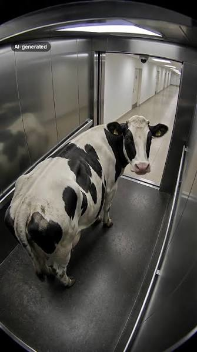

The Athletes Data Community Newsletter (ADCN) is a weekly update on advances in sports-related data collection, management, and reporting. Brad Stenger produces the ADCN. He is a PhD student at the University of Vermont and researches athletes’ data sharing and privacy.

### Sports Science Research Needs Its Own Tech Stack

The first time I heard the term "technology stack" was during the build-out stage of the Internet. There was [LAMP](https://www.reddit.com/r/webdev/comments/1cmd5kk/honest_question_what_happened_to_the_good_old/): Linux, Apache, MySQL, and PHP/Python. It was how to put a secure, reliable, interactive service on the nascent WWW. The term "stack" lives on, and even though it varies from one task to another, it still refers to the list of essential software elements needed for an Internet service on a website.

The organization that championed LAMP, O'Reilly Publishing, now touts [PARK](https://www.oreilly.com/radar/what-is-the-park-stack/), a contemporary technology AI stack for model builders with PyTorch, AI, Ray, and Kubernetes.

Sports science has a technology stack. Versions of it are easy to find: [Svexa](https://svexa.com/building-a-sports-science-stack-tools-every-elite-team-needs-in-2026/), [Justin Ochoa](https://simplifaster.com/articles/the-modern-performance-coachs-tech-stack/), [Vinciamo Sports](https://www.linkedin.com/pulse/from-moneyball-stack-era-how-ai-data-infrastructure-sports-tech-hdz4e/), [Driveline Baseball](https://drivelinebaseball.com/blogs/blog/a-look-under-the-hood-how-driveline-sport-science-collects-processes-and-analyzes-thousands-of-athletes-biomechanics-data), [FYTT](https://fytt.io/blog/the-backpack-problem-in-modern-s-c-why-more-tools-have-made-coaches-slower).  The stack's service revolves around collecting, analyzing, and reporting data related to athletes' health and performance. This is a lot of what I research, and I have lots to say, but first a story.

During an earlier stint in grad school, I interned with a large, global architecture firm that designed biomedical research labs. I wanted to learn how to build technology into collaborative research environments. It turned out that was not really the business of architects.

The architects I worked with spent long hours in conversation with lab directors, asking them what they wanted in their facility. These directors were the actual building designers. The process usually worked. I remember one time that it didn't.

The client needed a biocontainment laboratory and decided to put it on an upper floor in a new building for security. It also needed to bring cattle-size animals to their biosafety-level 4 rooms, requiring a giant elevator close to the loading dock. The architect asked the scientist, "How should we make this work for you?" The scientist replied, "I don't know. You tell me. You're the expert." But the architect wasn't the expert, just the assembler. Fortunately, the architect had a boss who was expert and had an answer.

Expertise is valuable in order to do things that haven't been done (or tried) before.  The technology stack for sports science is suboptimal for doing sports science research. Mollie Brewer just [presented a paper](https://dl.acm.org/doi/10.1145/3838843.3838845) at a conference in Germany saying as much. 

Sports science research has its version of the cow-elevator question: what goes into a sports science technology stack that meets the needs of researchers? The answer begs for an expert, and I'd like to go, "two thumbs pointing right here," but at present all I can do is outline the problem and describe a path to its solution. Something less than a solution. (Sorry.)

One complication for this particular tech stack is the range of different users who share tasks related to athletes' data. Performance coaches, medical staff, analysts, and sports administrators rely on some version of the athletes' data stack for decision-making. For many of these athletes' data stakeholders with admin responsibility, the stack is a single-vendor, turnkey athlete management system. 

A growing consensus has formed around [the information overload issue](https://fytt.io/blog/the-backpack-problem-in-modern-s-c-why-more-tools-have-made-coaches-slower), where too much data in their systems has slowed decision processes and created bottlenecks. "I'd rather build something that helps athletes, coaches, clinicians, and leaders understand together what's happening, be honest about what they can't see, act, and learn from it," Bryce Murphy from IMG writes in a recent Teamworks [blog post](https://teamworks.com/blog/welcome-to-the-decision-renaissance).

Streamlined systems are single-purpose, not multi-functional. Vendor systems gain customers and improve lock-in by adding functionality. Alternative tech stacks that are customized and open source can be a Frankenstein that requires technical and engineering know-how. The University of Waterloo has a student-based sports analytics support group that [published its tech stack](https://ww2.amstat.org/meetings/jsm/2026/onlineprogram/abstract.cfm?sid=7077&tid=7172) at JSM in August. 

The Waterloo tech stack supports 10-20 analysts and 8 intercollegiate teams. The infrastructure allows analysts to work in different programming languages (R, Python) and to blend personal and group workflows (unrestricted IDEs, GitHub, internal support packages). Conventions for code style and filenames keep things organized. Reports are produced in Quarto (static) and Shiny (interactive), chosen for cross-language support, and distributed via Posit Connect Cloud (easy automation, shareable URLs). 

Brewer's paper describes user interactions with the [UF Athletics Databank](https://aipoweredathletics.eng.ufl.edu/the-uf-athletics-databank/), as created by the AI-Powered Athletics initiative at the University of Florida. According to the university website, "The databank creates a scalable foundation for advanced analytics and artificial intelligence research in real-world collegiate sport settings, while also supporting informed decision-making and athlete performance operations across Gator Athletics." 

The care and effort to produce a shared data resource like this that is both secure and accessible is necessary for an athletes' data tech stack but by itself can only function as part of what's needed. A university environment can assume high levels of technical expertise and also high expectations for freedom to create the tech stack geared to the type of research under consideration. But that might mean that the wheel gets reinvented over and over.

What is needed to prevent the duplication is an open, interoperable layer in the tech stack that fits in between the data and the end-service. This is something that the JupyterHealth project seeks to provide research-based healthcare developers. The project recently earned a $10 million [moonshot grant](https://www.youtube.com/watch?v=7Kaydm-JpPQ) from the Laude Institute to build out its ambitious platform.

JupyterHealth builds on the Jupyter Project, which created the ubiquitous notebook coding interface for coding in Python. Jupyter notebooks evolved hand-in-hand with the emergence of data science in academia and elsewhere. (The Athletes Data Community Newsletter has a precursor, the [Data Science Community Newsletter](https://alliance4datascience.ai/resources/newsletter/), which ran from 2015-25 and peaked at 10,000 readers.)

Jupyter notebooks bundle and assemble data and code with additional privacy-preserving health data security that can then scale up to personal and public health services, first at the community level but realistically, eventually at population levels. According to the [recent editorial](https://www.researchgate.net/publication/417468718_Considering_the_case_for_computational_epidemiology_infrastructure_in_sport_and_exercise_medicine) by Avinash Chandran and Nicol van Dyk in the *British Journal of Sports Medicine*, infrastructure improvements are what's needed to unlock piles of accumulated athletes' data and mitigate sports injuries at a global scale.

Applying JupyterHealth to research questions in sports offers a collaborative framework and infrastructure for all sorts of grand challenges, like the computational epidemiology proposed by Chandran and van Dyk. Consider what's going on in [Sports Human-Computer Interaction](https://dl.acm.org/doi/10.1145/3613904.3642050), [Health Visualization](https://ieeevis.org/year/2026/program/content/d11a5dec-393e-460d-8f61-16e578417dd4/), [Wearable Technologies](https://onlinelibrary.wiley.com/doi/10.1002/ejsc.70270), and [OpenSim biomechanics](https://casrai.org/guides/opensim).

A platform like JupyterHealth that coalesces like-minded researchers on large problems can also connect health practitioners to individuals with the same sort of workflow. Bundle and assemble data and analysis, then use it to create services, but take it [all the way to the edge](https://edgemedicine.org/innovation-launch-recap) to ingest, process, and ultimately, feedback individual health information. Ida Sim, a JupyterHealth director and Berkeley professor, puts it this way: "What if the most important person on your care team was you?"

Collaborative work is possible with commercial athlete management systems. Teamworks has a product that the Southeastern Conference uses to [share athlete health records across universities](https://teamworks.com/blog/sec-teamworks). Catherine O'Neal, the person in charge of the SEC medical program, explains the use case, "We love to buy 15 different programs and then hope that some person who’s really supposed to be taking care of athletes at a bedside can go in the middle of the night and put all that data together, usually in an Excel spreadsheet." Useful, but more operational than research.

Nowhere is that more evident than when it comes to AI. The Athletic [describes](https://www.nytimes.com/athletic/7644119/2026/09/30/college-football-programs-ai-risk/?unlocked_article_code=1.FFE.Ag0d.3gbxrfAv1XzG&source=emp_shared_article&smid=url-share-ta) how the University of Florida uses its athletic databank with AI to make specific data available to trainers so that they can put it to use. Other schools (University of Nebraska, for one) use it as a game strategy assistant. The first example is pedestrian. The second is risky. Neither is especially insightful.

Teamworks CTO Reed Shaffner [outlined](https://teamworks.com/blog/the-future-of-ai-in-sports) the role AI should play in smart sports organizations. It is "a specialized layer sitting between your organization and whatever frontier models exist, with the models plugging in underneath as interchangeable engines. If one gets taken away tomorrow, your intelligence remains, because it was never stored in the model. It was stored in the layer you own."

JupyterHealth can function as a control and verification layer for AI model effectiveness in a high-privacy sandbox. The expertise that goes into bundling and assembling data and analysis should come with sufficient understanding of what AI can accurately contribute to an original research question. 

The stakes are higher for researchers when it comes to that specialized layer, and it will also be important for sports organizations that seek competitive advantage from research with data, and not just evidence-based decision-making. 

### TrueHoop Second-hand Interview

Henry Abbott spent a good chunk of time talking with me about NBA injuries. He is the founder of [Truehoop](https://x.com/truehoop) and author of last year's [*Ballistic*](https://wwnorton.com/books/9781324050148), a science-filled biography of Marcus Elliott. Abbott brought up our conversation at a couple of junctures during his [recent podcast](https://www.truehoop.com/p/live-with-henry-abbott-and-david-e3b). Check it out. Henry's smart and does a nice job putting context around player health, sports science, and NBA reality.

### News

[The historic (and absurd) longevity of Steph Curry and Kevin Durant](https://www.espn.com/nba/story/_/id/50434799/stephen-curry-kevin-durant-warriors-rockets) in *ESPN.com* by Ben Golliver on November 10, 2026

[Andreas Almgren’s New York City Marathon Debut](https://coros.com/stories/more-than-splits/c/andreas-almgren-nyc-marathon-debut) in *Coros Stories* on November 4, 2026

[Ralph Reiff on Tyrese Haliburton's Hamstring: Why Recovery is Complicated & Injuries Recur](https://www.youtube.com/watch?v=c6-6XaFaMMU) in YouTube, *Fieldhouse Files* by Scott Agness on November 1, 2026

[Why Cavan Sullivan is the perfect USMNT co-star for Christian Pulisic](https://www.espn.com/soccer/story/_/id/50443838/cavan-sullivan-usmnt-co-star-christian-pulisic-always-needed) in *ESPN.com* by John Muller on November 11, 2026

[Researchers track whole body movement with just a smartwatch](https://news.cornell.edu/stories/2026/11/researchers-track-whole-body-movement-just-smartwatch) in Cornell University, *Cornell Chronicle* by Patricia Waldron on November 11, 2026

[Tiny injectable glucose sensor could make blood sugar monitoring 10 times cheaper](https://www.digitaltrends.com/cool-tech/researchers-develop-a-low-cost-glucose-sensor-that-tracks-blood-sugar-using-light/) in *digitaltrends* by Rachit Agarwal on November 4, 2026

[Excited to share that Sports Business Journal announced the launch of Uplift Vision 2.0 today! ](https://www.linkedin.com/feed/update/urn:li:activity:7525967678935683072/) in *LinkedIn* by Sukemasa Kabayama on November 10, 2026

[How the Hurricanes became the NHL’s new standard: Inside the culture behind the champs](https://www.nytimes.com/athletic/7751574/2026/11/11/brindamour-staal-tulsky-dundon-carolina-culture/) in *The Athletic* by Joe Smith on November 11, 2026

[A crisis mismanaged: Inside 57 days of tragedy and turmoil at Arizona State](https://www.nytimes.com/athletic/7753514/2026/11/12/arizona-state-hockey-tragedy-coach-athletic-department/) in *The Athletic* by Katie Strang, Adam Kilgore, Nathan Fenno on November 12, 2026

[Sea cucumber-inspired gel could help heal damaged tissue in humans](https://uwaterloo.ca/news/media/sea-cucumber-inspired-gel-could-help-heal-damaged-tissue) in University of Waterloo, *Waterloo News* on October 20, 2026

[Oura adds two new cardiovascular health tracking features to its smart rings](https://www.theverge.com/tech/1014712/oura-smart-rings-track-cardio-effort-vo2-max-cardiovascular) in *The Verge* by Andrew Liszewski on October 20, 2026

[Whoop launched a social network where every user has a ‘verified heartbeat’](https://www.theverge.com/gadgets/1032630/whoop-humans-social-network) in *The Verge* by Stevie Bonifield on November 12, 2026

[Inside NSF’s ‘Depressing’ New Headquarters](https://www.aip.org/fyi/inside-nsfs-depressing-new-headquarters) in AIP, *FYI: Science Policy News* by Lindsay McKenzie on November 11, 2026

[NCAA warns multiple transfers tied to sharply lower graduation rates in college football](https://apnews.com/article/ncaa-graduation-rates-eligibility-d1eea4d8a3a78a5e747b0ae1a9c89ede) in *Associated Press* by Eddie Pells on November 11, 2026

[Seeing is Believing, but Pitchers Lie](https://medium.com/@ansrud/can-a-batter-tell-a-pitch-from-how-it-was-thrown-8015caf92a2e) in *Medium* by Stephen on November 12, 2026

[For Francis Tiafoe, the ATP Finals is the destination of a journey into the unknown](https://www.nytimes.com/athletic/7777254/2026/11/14/frances-tiafoe-tennis-atp-finals-mindset-improvement/) in *The Athletic* by Matthew Futterman on November 14, 2026

[College Football All-22 Film Is Available for 100+ Teams, Finally](https://www.sportico.com/leagues/football/2026/college-football-all-22-coaches-film-streaming-app-1234957895/?bt_ee=FmNfDml55cip-o8hkFI-jkTw52jm-EtWV4WaQKL2hCrLOkFYCS6VpPLP7SBljhSe4TrigUDkggnMORMBTalm0g%3D%3D&bt_ts=1794315597124) in *Sportico* by Jacob Feldman on November 10, 2026

[Sources: Chiefs had renowned baseball doctors weigh in on Patrick Mahomes' elbow](https://www.espn.com/nfl/story/_/id/50481210/sources-baseball-doctors-consulted-patrick-mahomes-elbow) in *ESPN.com* by Adam Schefter on November 15, 2026

[Heat Training Practices in Elite and World-Class Athletes: A Review of Preparation Strategies for Competition in Hot Outdoor Environments](https://link.springer.com/article/10.1007/s40279-026-02562-w) in *Sports Medicine* journal by Joshua Elliott et al. on November 12, 2026

[Evaluation of a smartphone-based markerless motion capture system for assessing the kinematics of gymnastics](https://www.sciencedirect.com/science/article/pii/S0021929026003325) in *Journal of Biomechanics* by Lucy Buchanan et al. on November 11, 2026

[Real Madrid medical chief insists player health should take priority over football calendar: ‘We need to raise awareness’](https://sports.yahoo.com/articles/real-madrid-medical-chief-insists-112600422.html) in Yahoo Sports, *Madrid Universal* on November 10, 2026

[For Years, She Felt Awful. Her Flexible Joints Held a Clue.](https://www.nytimes.com/2026/11/09/well/heds-eds-hypermobile.html) in *The New York Times* by Elizabeth Anne Brown on November 9, 2026

[MLB already has a salary cap. Ask Alec Bohm.](https://www.outinleft.com/p/alec-bohm-proves-mlb-already-has) in Substack, *Out in Left* newsletter by Brendan Dentino on November 8, 2026