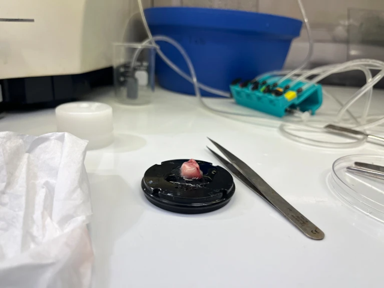

The Athletes Data Community Newsletter (ADCN) is a weekly update on advances in sports-related data collection, management, and reporting. Brad Stenger produces the ADCN. He is a PhD student at the University of Vermont and researches athletes’ data sharing and privacy.

### Athletes Data Changes Coaching

The first-ever [Football Analytics Symposium](https://csds.tamu.edu/football-analytics-symposium/) at Texas A&M (FAST) took place on Friday, November 13. The next day the Aggies football team suffered a 15-point conference loss on its home field to Tennessee. *USA Today* writer Matt Hayes [called this year's team "irrelevant"](https://www.usatoday.com/story/sports/ncaaf/sec/2026/11/14/mike-elko-apology-texas-am-football-tennessee-loss-marcel-reed/92791158007/) one year after being one of 12 teams in last season's College Football Playoff.

"It’s a completely non-functional offense, and that’s on me," is the quote from Mike Elko in the article that listed a litany of bad Elko decisions. "It’s my fault. I own it. Come after me." A week earlier, the team lost to South Carolina, 17-9. That game saw the Aggies produce 450 yards in offense with no turnovers and no touchdowns—[a first in NCAA football history](https://sports.yahoo.com/articles/mike-elko-sends-clear-message-150035969.html).

Last week the Texas A&M athletic director, Trev Alberts, left the school to become AD at the University of Michigan. Elko [expressed confidence](https://sports.yahoo.com/articles/mike-elko-sends-clear-message-150035969.html) that he and his school can still be trusted to make better decisions in the future.

Institutional enthusiasm for analytics has little correlation to quality coaching decisions. And today's coaches are all about decision-making. Before the season, it's personnel decisions. During the season it's athlete development and game preparation. Each game has its play-by-play tactical execution. Elko, it appeared, failed at each level, and just like he asked for, people are coming after him.

Competence and coaching are difficult to peg to any meaningful standard. You are up. You get paid. Then you're down. You get fired.

One coach who rises, falls, rises again, and keeps getting paid is Mauricio Pochettino, former coach of the US Mens national soccer team (USMNT) who took the job in the Premier League at Manchester United. That may be because he truly is [a superior coach](https://bsky.app/profile/tombogert.bsky.social/post/3n2mygpr67s26).

Ryan O'Hanlon told the [Double Pivot podcast](https://www.expectinggoals.com/p/the-state-of-the-premier-league-in) that soccer coaches fit into one of two buckets. One will match players to his tactical system, and the other will determine a tactical system that matches squad players on hand. Team management has the task to get players consistent with the coach, either fitting the system roles or possessing talents that allow for coaching creativity.

Pochettino does both, and more. With his USMNT departure, he has been getting credit for developing young players and for building a competitive culture, putting the national team on a solid footing for his successor.

"Most of what a national team manager does—scouting the player pool, managing relationships with his players and their clubs, projecting out performance on a multiyear performance timeline for his roster—has little in common with the next-game-up, tactical obsession that drives the club game," O'Hanlon [wrote about top-tier soccer coaches](https://www.espn.com/soccer/story/_/id/50079068/from-usmnt-germany-why-club-coaches-taking-national-teams) for *ESPN.com*. Polymath coaches, like Pochettino, thrive in situations that put all of their skills on display.

Managing relationships might be the part of the coach's job description where athletes' data can affect success.

Baseball teams have championed analytics, R&D, and player development for competitive advantage. As the Boston Red Sox season closed with playoff losses to the New York Yankees, two players, Sonny Gray and Willson Contreras, [were vocal critics](https://bosoxinjection.com/red-sox-insider-reveals-willson-contreras-drama-isnt-players-first-mutiny-of-2026) of analytics-based decisions by the Red Sox. Boston rewarded its head coach, Chad Tracy, with a three-year contact. Tracy will need to [gain locker room support](https://www.nytimes.com/athletic/7669470/2026/10/08/chad-tracy-red-sox-manager-playoffs/).

Established professional athletes can have this back and forth with their coaches, where early-career pros and college athletes probably cannot afford to be so vocal.

Teams' control over data has created [a value gap](https://papers.ssrn.com/sol3/papers.cfm?abstract_id=7691998) between what happens with athletes' data and what athletes get for their data, according to the Miami-based law student and player agent, Sean Louisaint.

Louisaint describes [a snippet](https://www.cbssports.com/college-basketball/news/dukes-paolo-banchero-reportedly-loses-seven-pounds-per-game-due-to-heavy-sweating/) from a 2021 ESPN telecast of an early-season basketball game between Duke and Ohio State. The sideline reporter, Holly Rowe, mentions that star forward Paolo Banchero sweats a lot, seven or so gallons over the course of the game. Louisant asks, "When schools and their partners collect information about an athlete’s body, who decides whether that information becomes part of the product they sell?"

There is no record that Banchero consented to this fun fact. Most likely, he did not. The reason for athletes' data collection can be expressed as part of athletes' medical care. Sometimes that information spills out in kinds of data sharing that are entertainment, or education, or anecdote—collateral expression from the torrent of sports science information.

This sort of disclosure sometimes occurs in professional sports' broadcasts, but an athlete's permission will be negotiated in advance of the commentary. If the data is collected as part of the league's Next Gen Stat partner program with a corporate sponsor, then it is okay. Both cases are collectively bargained between the players and the league.

College athletes have no collective bargaining and operate without any protections for their data. Government regulation of their biometric data offers protection, but only in a vague sense. Only Virginia has a statute that specifies athletes data rights. The effect of the statute is that athletes who have an NIL agreement will also need to have a second separate agreement that describes the protections for their personal, biometric data.

Standard practice between coaches and athletes with regard to athletes' data sharing and privacy was described in a 2020 computer science [research paper](https://dl.acm.org/doi/10.1145/3375185) by Samantha Kolovson from the University of Washington. Kolovson describes the power asymmetries between coaches and their players. Coaches have authority to collect, view, and share athletes' data. Athletes will surrender their data with little or no expectation that they will see how it gets used. 

"Extraction" is the adjective that Kolovson uses to describe the data exchange. Extraction is the term used for data privacy and governance when personal data is [collected, aggregated, and applied en masse](https://academic.oup.com/rof/article/29/5/1337/8171530) with little or no awareness from that data's source. In the sports context, athletes' data extraction resembles the large-scale extraction of consumers' data as typically occurs with their credit cards or their web browsing ad tech.

Louisaint reports that the justification for athletes' data collection is medical care, since most of the data fits into the frame of athletes' health and performance. But the gym, field, rink, and pitch are not clinical settings, and they do not generate privacy protection from federal HIPAA rules.

At some point, personal data gets invasive. Banchero and his sweat might come close, but not close enough to stay off of a national sports broadcast. Female athletes' periods and monthly cycles might cross a line. It depends on the athlete and the audience. The greater potential offense to athletes is not embarrassment as much as it is analytics.

The Red Sox have constructed rules for when pitchers get removed based on workload and situation. Sonny Gray wants the ball in high leverage situations during the middle of the game against the Yankees. The rules say no. The rules piss off Sonny Gray.

This is the changing dynamic between coaches and players. Coaches who prove their planning and situational abilities on a daily basis probably devote substantial effort to be the very best at their job. It is probably easier for athletes to sacrifice their preferred outcome, to accept their coach's decision, and to do their job when their coach works as hard or harder than they do, and cares as much or more than they do.

### Concussions

Medical research into football concussions is [having a moment](https://www.truehoop.com/p/check-your-head). It started with a Boston University study that extrapolated CTE study results and revealed a surprisingly pervasive presence for brain damage in the football retiree population. [The study](https://jamanetwork.com/journals/jamanetworkopen/fullarticle/2855918?guestAccessKey=a618516b-4b13-4b0d-81a1-7531da4aaa59) estimated that 75% of former professional football players who died between 2008-23 had CTE. By only measuring the deceased and not living football players, the study probably overstates the presence of CTE in the larger NFL retiree population.

[New research](https://med.stanford.edu/news/all-news/2026/11/concussion-study.html) by Stanford bioengineers used a mouthguard sensor to differentiate between linear forces (straight-on collisions) and rotational forces (collisions at an angle). It had been thought that rotational forces were the primary driver of concussions. “Not only is the linear acceleration predictive of concussion, the threshold is lower than people had previously thought in terms of the levels that are unsafe,” said Jessica Towns to a *Stanford Medicine* news reporter. The work points to increased benefit from things like Guardian Caps, the extra padding that sits above the hard plastic shell of a normal football helmet.

Axons are the main trunk and the workhorses in brain neuron networks. Their transmission signals can move faster and respond with greater sensitivity than other neuron types. They are thought to play a crucial role in complex brain functions. Years ago, Eric Nauman, who researches [helmets and head impacts](https://www.uc.edu/news/articles/2026/08/one-in-four-nfl-players-had-cte-at-death.html) at the University of Cincinnati, asked me rhetorically, "What does a busted axon look like?," before answering, "Nobody knows." 

A *Nature.com* [feature article](https://www.nature.com/articles/d41586-026-03711-x?utm_source=bluesky&utm_medium=social&utm_campaign=nature&linkId=64428795) described imaging techniques for visualizing human brain tissue. Hungarian researchers have been collecting the brain tissue discarded during surgeries (pictured above, credit: Rennie Kendrick). They do real tissue studies examining the firing patterns for axons and how they might change depending on situations, like aging. Progress.

US university researchers [have identified a protein biomarker](https://www.nytimes.com/2026/11/19/science/cte-blood-test-diagnosis.html), eMTBR-tau243, that is associated with Alzheimer's disease and is probably also a factor in CTE. Recent work at the University of California-San Francisco, Boston University, and Banner Health hope that it can be used to develop a CTE diagnostic test. The test would identify CTE in living tissues. CTE can now only be diagnosed after a person has died and if that person has donated their autopsy results to research.

### News

[SportsHCI 2026: Proceedings of the Second Annual Conference on Sports and Human-Computer Interaction](https://dl.acm.org/doi/proceedings/10.1145/3838843) in *ACM Digital Library* by Editors: Florian Daiber, Danny Harrison, Kristy Boyer, Paula Alexandra Silva, Dennis Reidsma, Aswin Balasubramaniam,Nihar on November 15, 2026

[Yesterday, doctoral student Mackenzie Barrowman, MS, was in the lab getting our motion capture setup ready for round two of the Bobcat SHIELD study at Ohio University.](https://www.linkedin.com/feed/update/urn:li:activity:7528820025680384001/) in *LinkedIn* by Melissa Anderson on November 19, 2026

[WPSL Pro’s ramp-up season features regional groups playing eight to ten matches that build to playoffs and a title. It’s our first step toward WPSL Pro’s inaugural season. Applications to play are open.](https://wpslpro.com/) on November 12, 2026

[“It’s So Easy as an American”: Navigating Post-Athletic Transitions and Systemic Stressors Among International College Athletes](https://scholarcommons.sc.edu/jiia/vol19/iss1/24/) in *Journal of Issues in Intercollegiate Athletics* by Simran K. Sethi, Natalie Bunch, Tarkington J. Newman on November 1, 2026

[The NBA says load management doesn't work and they're right](https://fansided.com/nba/the-nba-says-load-management-doesnt-work-and-theyre-right) in *Fansided* by Lucas Seehafer on November 16, 2026

[Does basketball cause injuries?](https://www.truehoop.com/p/does-basketball-cause-injuries) in Substack, *TrueHoop* newsletter by Henry Abbott on November 19, 2026

[Revised Protect College Sports Act allows conferences to expand up to 22 schools](https://www.espn.com/college-sports/story/_/id/50545220/protect-college-sports-act-revised-donald-trump-voices-support) in *ESPN.com* by Dan Murphy on November 20, 2026

[House to debate slightly tweaked version of Protect College Sports Act](https://apnews.com/article/congress-college-sports-680a1c8be29a706a6d249d234571747c) in *Associated Press* by Eddie Pells on November 20, 2026

[Kansas City's NWSL title shows investing in women's soccer pays off](https://www.espn.com/soccer/story/_/id/50561566/kansas-city-nwsl-championship-final-washington-spirit) in *ESPN.com* by Jeff Kassouf on November 22, 2026

[Ben Shelton is one of the least boring tennis players in the world, except when it comes to how he measures and approaches improvement. Spoiler alert -- it's working.](https://bsky.app/profile/mattfutterman.bsky.social/post/3n2izdl6cx22o) in *Bluesky* by Matthew Futterman on November 17, 2026

[Ben Shelton’s Pliable Ceiling](https://www.tennisabstract.com/blog/2026/11/17/ben-sheltons-pliable-ceiling/) in *Tennis Abstract*, "Heavy Topsin" blog by Jeff Sackmann on November 17, 2026

[Protecting Player Welfare: Why Football Needs a Game-Wide Approach](https://www.kitmanlabs.com/video/protecting-player-welfare-game-wide-approach/) by *TalkSport*, Kitman Labs on October 22, 2026

[Women’s Soccer Performance Science: A Practitioner Benchmarking Survey](https://svexa.com/womens-soccer-performance-science/) by Svexa on November 10, 2026 

[Profiting From Prediction](https://papers.ssrn.com/sol3/papers.cfm?abstract_id=7715258) in *SSRN* by Veronica Root Martinez, Gina-Gail S. Fletcher, Emilie Aguirre on November 17, 2026

[Gambling Risk Among College Athletes in the Context of Legalized Sports Betting A Narrative Review](https://papers.ssrn.com/sol3/papers.cfm?abstract_id=7692426) in *SSRN* by Maria Aladjova, Justin Jacques, Adrienne Renwick, Cass Dykeman on November 16, 2026 

[Jess McClain's Second-Place Finish Was Just the Start](https://www.theskimm.com/sports/in-her-court/jess-mcclain-quotes-nyc-marathon-interview) in *theSkimm* by Anna Davies and Kylie McConville on November 10, 2026

[Nike Announces Project Shield with University Collaborators to Reduce Injury in Female Athletes](https://about.nike.com/en/newsroom/releases/nike-announces-project-shield-with-university-collaborators-to-reduce-injury-in-female-athletes) in *Nike Newsroom* on November 12, 2026

[Our reporter mailed off her poo to find out what two companies say about her microbiome. Here’s what she found.](https://bsky.app/profile/nature.com/post/3n2tam44cyr2o) in *Bluesky*, *Nature.com* on November 21, 2026

[The payoff is the best part](https://bsky.app/profile/leanderalphabet.bsky.social/post/3n2s7gcgefk2w) in *Bluesky* by Leander Schaerlaeckens on November 20, 2026

[USA Volleyball Acquires New 142,000-square-foot Training Facility in Southern California](https://sports.yahoo.com/articles/usa-volleyball-acquires-142-000-154454368.html) in Yahoo, *Volleyball on SI* by Nicole Reitz on November 20, 2026

[Diego Chara says everything changes at 35. He could've retired then & gone down as a Portland Timbers legend. We talked about why, then, he is going until he's 41.](https://bsky.app/profile/jonarnoldfc.bsky.social/post/3n2qnfbvkwk2y) in *Bluesky*, *USA Today Sports* by Jon Arnold on November 20, 2026

[Oura Ring 4 was the most accurate wearable for overnight HRV, and no watch measured VO2max well. I've charted nine measurements.](https://bsky.app/profile/the5krunner.bsky.social/post/3n2pcmnelhs2q) in *Bluesky* by the5krunner on November 19, 2026

[Wastewater pathogen composition in Atlanta, GA prior to and during the 2026 FIFA World Cup](https://medrxiv.org/lookup/doi/10.64898/2026.11.03.26366867) in *medRxiv* by Nina Raymo et al. on November 5, 2026

[The research papers from Hudl Performance Insights 2026 are available to read now](https://bsky.app/profile/statsbomb.com/post/3n2og27f2z22s) in *Bluesky* by Hudl Statsbomb on November 19, 2026

[How Utah football weathered its travel chaos with ‘nasty’ cherry drinks and sports science](https://www.sltrib.com/sports/utah-utes/2026/11/16/nasty-drinks-sports-science-inside/) in *The Salt Lake Tribune* by Jason Batacao on November 16, 2026

[Running the Numbers: High Metabolic Load Distance as an Alternative to Traditional External Load Metrics in Elite Women's Football](https://onlinelibrary.wiley.com/doi/10.1002/ejsc.70288) in *European Journal of Sports Science* by Joshua Waugh et al. on November 13, 2026

[Chronic Ankle Instability: An Evidence-Based Framework of Constitutional and Consequential Determinants](https://sportrxiv.org/index.php/server/preprint/view/1147) in *SportRxiv* by Eli Schmidt et al. on November 17, 2026
